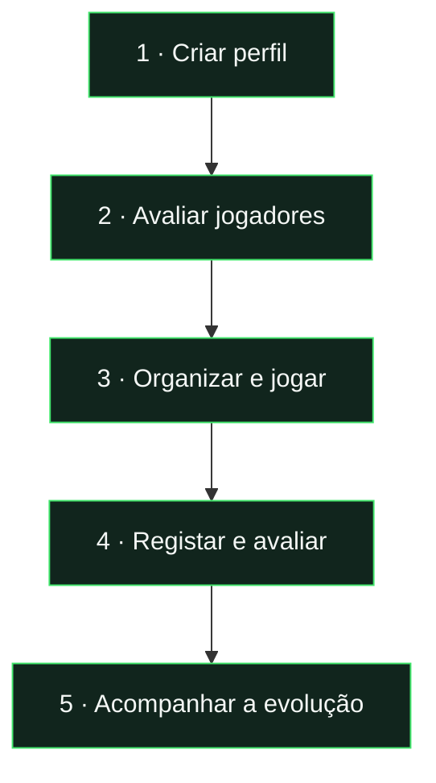
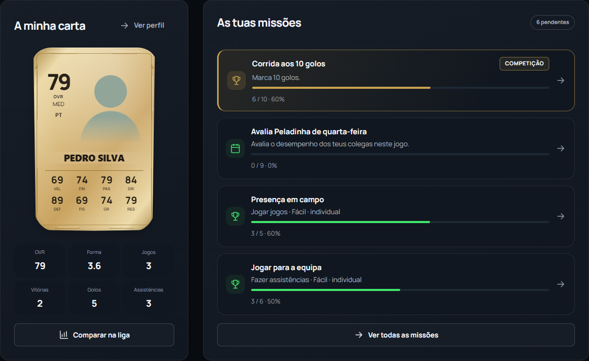
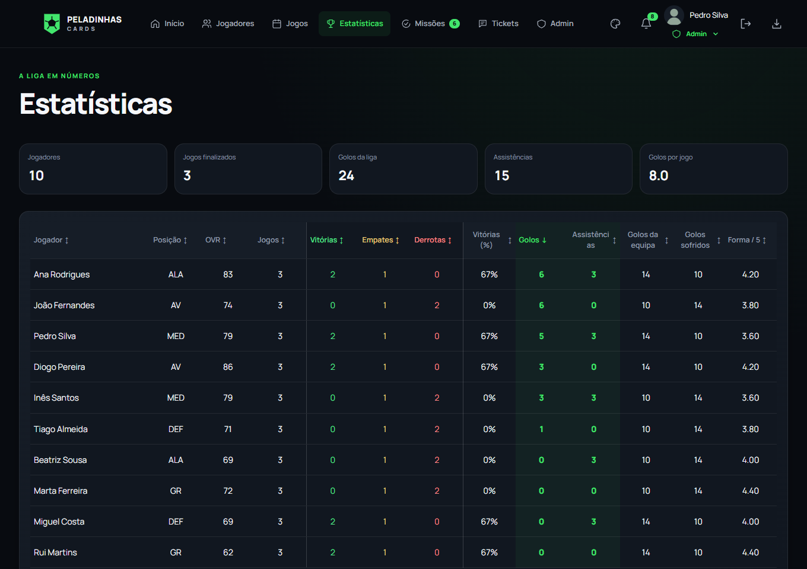
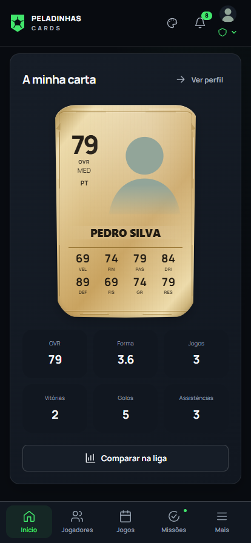

**Gestão de jogos, avaliação de jogadores e acompanhamento de uma comunidade de futebol.**

[Aplicação ↗](https://pedalinhas-cards.web.app/) &nbsp; · &nbsp; [Funcionalidades](#funcionalidades) &nbsp; · &nbsp; [Documentação](docs/README.md)

## Como funciona

| O jogador                         | A organização                      | A comunidade                             |
| :-------------------------------- | :--------------------------------- | :--------------------------------------- |
| Gere o perfil e consulta a carta. | Prepara equipas e regista jogos.   | Avalia jogadores e participa em eventos. |
| Acompanha resultados e progresso. | Configura objetivos e recompensas. | Consulta estatísticas e classificações.  |

## Funcionalidades

### Painel pessoal

**Carta e OVR** · Forma recente · Jogos e contribuições · Missões · Destaques semanais

### Cartas e avaliações

| Conceito         | O que representa                                                  |
| :--------------- | :---------------------------------------------------------------- |
| **Carta**        | Fotografia, posição, nacionalidade e atributos do jogador.        |
| **12 atributos** | Capacidades individuais avaliadas pela comunidade.                |
| **OVR**          | Classificação geral, ponderada pela posição principal.            |
| **Evolução**     | Alterações nos atributos a partir dos jogos e avaliações válidas. |
| **Histórico**    | Cartas semanais guardadas para consultar o percurso.              |

Os valores da galeria ilustram os estilos, não os limiares das raridades.

[Como se calcula a carta →](docs/reference/cards-and-ratings.md) · [Como funciona a progressão →](docs/reference/progression.md)

### Jogos e equipas

| Antes do jogo                   | Depois do jogo                                   |
| :------------------------------ | :----------------------------------------------- |
| Definir data e local.           | Registar resultado, golos e assistências.        |
| Escolher titulares e suplentes. | Recolher avaliações dos participantes elegíveis. |
| Usar o sorteio equilibrado.     | Atualizar estatísticas e progressão.             |

### Estatísticas e ranking

**Comparar e ordenar:** OVR · Forma · Jogos · Vitórias · Golos · Assistências · Taxa de vitória

O ranking semanal destaca o desempenho recente. Sem avaliações suficientes, utiliza o OVR como referência.

### Missões e eventos

| Missão                                      | Competição                                          | Votação                                          |
| :------------------------------------------ | :-------------------------------------------------- | :----------------------------------------------- |
| Cumprir um objetivo individual ou coletivo. | Atingir uma meta antes dos restantes participantes. | Escolher candidatos segundo as regras do evento. |
| Cada participante elegível pode concluir.   | As posições premiadas são limitadas.                | O resultado pode exigir confirmação.             |

**Recompensas:** melhorias de atributos e cartas, conforme a configuração e os limites do evento.

[Objetivos, regras e recompensas →](docs/reference/events-and-missions.md)

### Card Lab e personalização

**Card Lab:** modelos · camadas · paletas · molduras · fotografia · composições guardadas

**Temas da interface:** Club Original · Volt Arena · Champions Night · Ultimate 20

### Gestão e apoio

| Membro                                 | DBS                                                  | Administrador                                    |
| :------------------------------------- | :--------------------------------------------------- | :----------------------------------------------- |
| Perfil, avaliações, eventos e tickets. | Capacidades de membro e gestão dos jogos permitidos. | Jogadores, papéis, cartas, OVR, eventos e apoio. |

As permissões são verificadas no servidor e nas regras de acesso aos dados.

## No telemóvel

### Uma PWA instalável

| No dispositivo   | Como funciona                                                    |
| :--------------- | :--------------------------------------------------------------- |
| **Android**      | Instalação pelo browser compatível.                              |
| **iPhone**       | Safari → Partilhar → Adicionar ao ecrã principal.                |
| **Arranque**     | Ícone próprio e janela de aplicação.                             |
| **Interface**    | Navegação e controlos adaptados ao telemóvel.                    |
| **Atualizações** | Opção de atualizar ou adiar.                                     |
| **Sem rede**     | Ecrã de recuperação; os dados da liga exigem Internet.           |
| **Alertas**      | Web Push mediante suporte, permissão e configuração do servidor. |

[Instalação e offline →](docs/guides/pwa.md) · [Notificações e configuração →](docs/guides/notifications.md)

Capturas da aplicação real com dados fictícios. A entrega push nos aparelhos depende da configuração do serviço; consultar o guia de notificações.

## Tecnologia e documentação

**HTML + CSS + JavaScript** → **Firebase Authentication · Firestore · Storage · Cloud Functions**

| Quero…                   | Consultar                                                                        |
| :----------------------- | :------------------------------------------------------------------------------- |
| Explorar a documentação  | [Mapa da documentação](docs/README.md)                                           |
| Executar e testar        | [Desenvolvimento](docs/guides/development.md) · [Testes](docs/guides/testing.md) |
| Perceber a estrutura     | [Arquitetura](docs/reference/architecture.md)                                    |
| Publicar uma atualização | [Publicação](docs/guides/deployment.md)                                          |
| Trabalhar nos visuais    | [Recursos de design](design/README.md)                                           |

---

**Peladinhas Cards** · [Aplicação ↗](https://pedalinhas-cards.web.app/) · [Documentação](docs/README.md)

