

 

**Uma plataforma para organizar jogos de futebol, avaliar jogadores e acompanhar a evolução da liga.**

Perfis individuais · Equipas e resultados · Cartas de jogador · Estatísticas · Eventos e missões

 

 

<a href="https://pedalinhas-cards.web.app/"><strong>Abrir a aplicação ↗</strong></a>
&nbsp; · &nbsp;
<a href="#explorar-a-aplicação">Explorar a aplicação</a>
&nbsp; · &nbsp;
<a href="docs/README.md">Documentação</a>

  

## O projeto

**Peladinhas Cards** reúne num único website a gestão de uma comunidade de futebol amador. A organização prepara os encontros e regista o que acontece em campo; os jogadores consultam as equipas, avaliam os colegas e acompanham o seu desempenho.

Cada membro tem uma carta com fotografia, posição, atributos e classificação geral (OVR). As avaliações estabelecem a base da carta; os jogos alimentam a progressão. Estatísticas, classificações e cartas semanais permitem acompanhar a evolução individual e comparar a liga.

<table>
<tr>
<td width="33%" valign="top">

### Para os jogadores

Consultar a carta, os jogos e as estatísticas. Avaliar colegas, cumprir objetivos e acompanhar eventos.

</td>
<td width="33%" valign="top">

### Para a organização

Preparar equipas, registar resultados e gerir jogadores, avaliações, eventos e recompensas.

</td>
<td width="33%" valign="top">

### No computador e telemóvel

Aceder pelo browser ou instalar a PWA, com navegação e layouts adaptados ao dispositivo.

</td>
</tr>
</table>

## Explorar a aplicação

| Visão geral                                          | Participar na liga                                                        | Organização                                      |
| :--------------------------------------------------- | :------------------------------------------------------------------------ | :----------------------------------------------- |
| [01 · Início e navegação](#01--início-e-navegação)   | [04 · Jogos e equipas](#04--jogos-e-equipas)                              | [09 · Administração](#09--administração)         |
| [02 · Jogadores e perfis](#02--jogadores-e-perfis)   | [05 · Avaliações pós-jogo](#05--avaliações-pós-jogo)                      | [10 · Card Lab e temas](#10--card-lab-e-temas)   |
| [03 · Cartas e histórico](#03--cartas-e-histórico)   | [06 · Estatísticas e ranking](#06--estatísticas-e-ranking)                | [11 · Apoio e mensagens](#11--apoio-e-mensagens) |
| [12 · Mobile e instalação](#12--mobile-e-instalação) | [07 · Missões](#07--missões) · [08 · Eventos](#08--eventos-e-competições) | [Documentação técnica](#documentação-técnica)    |

As capturas são exemplos de desenvolvimento e não confirmam a versão publicada. A referência técnica descreve as regras atuais. Todas as capturas apresentam a aplicação real com uma liga fictícia. Nomes, jogos, avaliações e mensagens são dados de demonstração. Alguns ecrãs mostram ferramentas reservadas à organização.

## 01 · Início e navegação

O painel inicial reúne os destaques semanais e os acessos mais usados. A carta pessoal, os indicadores de desempenho, as missões pendentes e os últimos jogos permitem perceber o estado da liga sem percorrer todas as páginas.

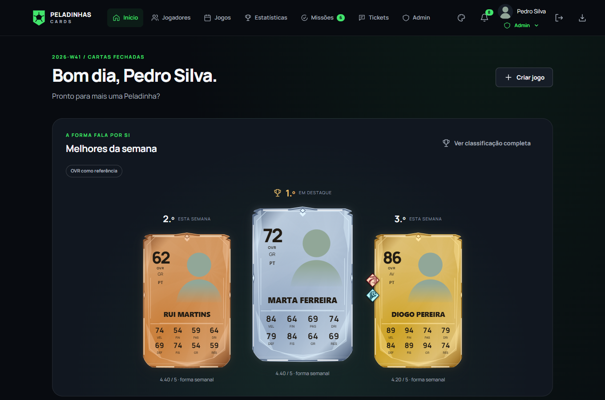

### Carta pessoal e tarefas pendentes

Os seis indicadores pessoais resumem a participação e as contribuições. Ao lado, o painel de missões destaca as competições e as próximas tarefas, com acesso à lista completa.

### O que encontras em cada menu

| Área             | O que permite fazer                                              |
| :--------------- | :--------------------------------------------------------------- |
| **Início**       | Consultar destaques, carta pessoal, missões e últimos jogos.     |
| **Jogadores**    | Explorar o plantel, pesquisar membros e abrir os seus perfis.    |
| **Jogos**        | Consultar encontros e resultados; gerir jogos quando autorizado. |
| **Estatísticas** | Comparar participação, resultados e contribuições dos jogadores. |
| **Missões**      | Acompanhar objetivos e avaliações por concluir.                  |
| **Tickets**      | Enviar pedidos de apoio e acompanhar respostas.                  |
| **Admin**        | Aceder à gestão da liga, conforme as permissões da conta.        |

O cabeçalho dá também acesso ao perfil, às notificações, aos temas e ao fim de sessão. No telemóvel, os destinos principais ficam na navegação inferior e os restantes no menu **Mais**.

O pódio alterna OVR, Performance e Crescimento. No PC, as bases distinguem claramente 1.º, 2.º e 3.º lugares; o título e a descrição ficam orientados à direita. A escala adapta-se à altura da janela. Os painéis **A minha carta** e **As tuas missões** têm a mesma altura quando estão lado a lado; o bloco de próximo jogo foi retirado da carta pessoal.

## 02 · Jogadores e perfis

### O plantel

A área de jogadores apresenta as cartas da comunidade. A pesquisa e a ordenação ajudam a encontrar um membro e a consultar os seus dados antes de abrir o perfil completo.

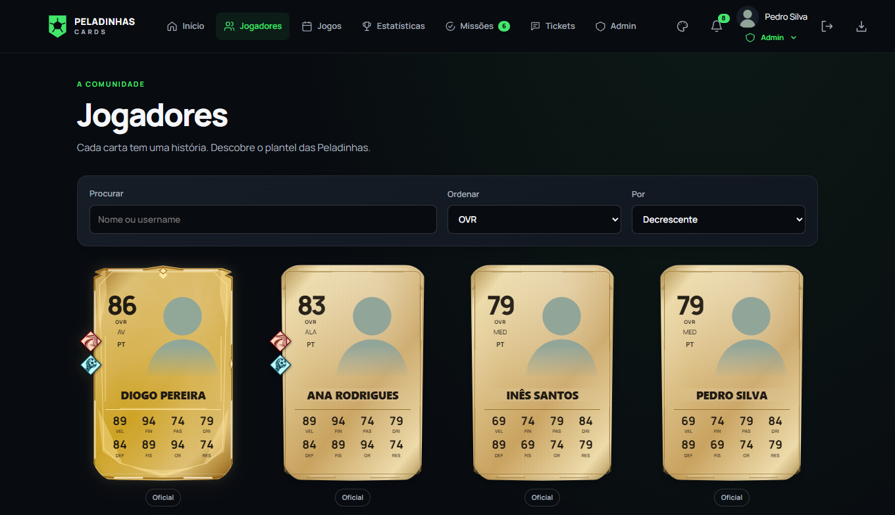

### O perfil individual

O perfil reúne a carta e os dados do jogador: nacionalidade, posição, altura, pé preferido e número. Mostra também os atributos, a forma recente, as estatísticas, o histórico semanal e os últimos jogos.

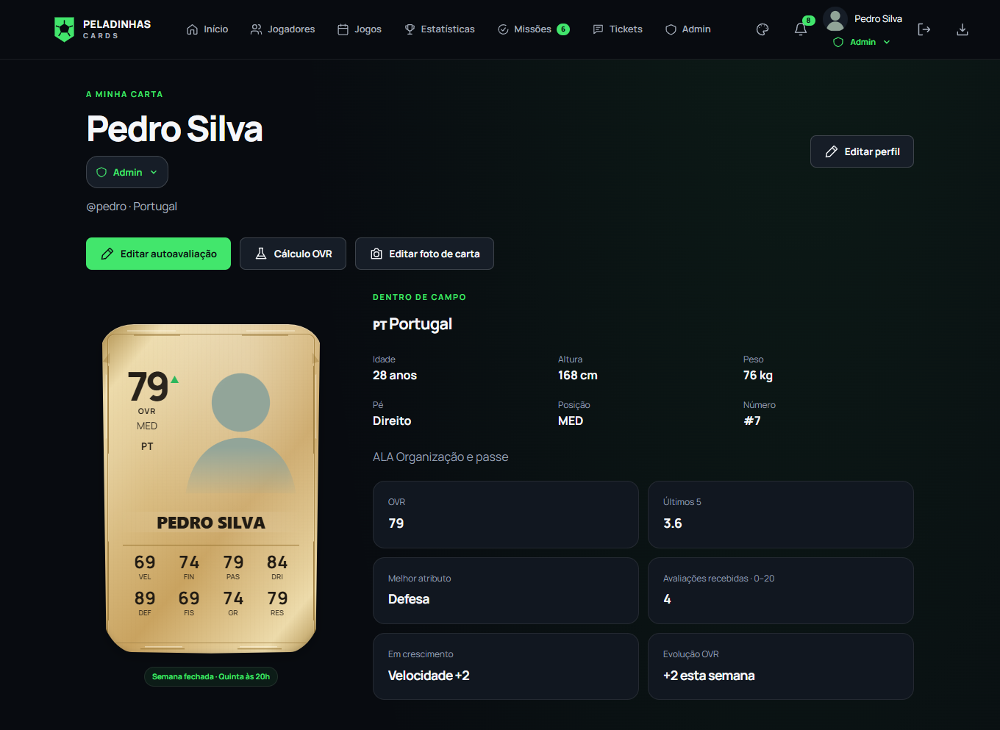

| Identidade                       | Desempenho                             | Evolução                                     |
| :------------------------------- | :------------------------------------- | :------------------------------------------- |
| Fotografia e dados do perfil.    | OVR, forma, jogos e resultados.        | Comparação com a semana anterior.            |
| Posição principal e secundárias. | Golos, assistências e taxa de vitória. | Atributos em crescimento e cartas guardadas. |

O jogador pode editar o próprio perfil. As ações de avaliação e gestão apresentadas dependem da conta e das regras de elegibilidade.

## 03 · Cartas e histórico

### A carta do jogador

A carta traduz os dados do perfil e as avaliações numa identidade visual comum à liga. O **OVR** é a classificação geral: combina os 12 atributos com pesos próprios para a posição principal.

| Elemento                 | Como funciona                                                              |
| :----------------------- | :------------------------------------------------------------------------- |
| **Primeira carta**       | A autoavaliação completa permite criar a base inicial.                     |
| **Comunidade**           | As avaliações externas passam a contribuir para essa base.                 |
| **Carta oficial**        | É atingida com três avaliações externas completas.                         |
| **Progressão**           | Jogos e avaliações válidas alteram os atributos segundo as regras da liga. |
| **Raridade e especiais** | Refletem os critérios de classificação e as recompensas atribuídas.        |

A galeria ilustra os estilos. Os valores apresentados não representam os limiares das raridades.

### Uma carta guardada por semana

O histórico permite consultar as cartas de semanas anteriores e ampliá-las. As cartas fechadas conservam os valores e a aparência desse momento.

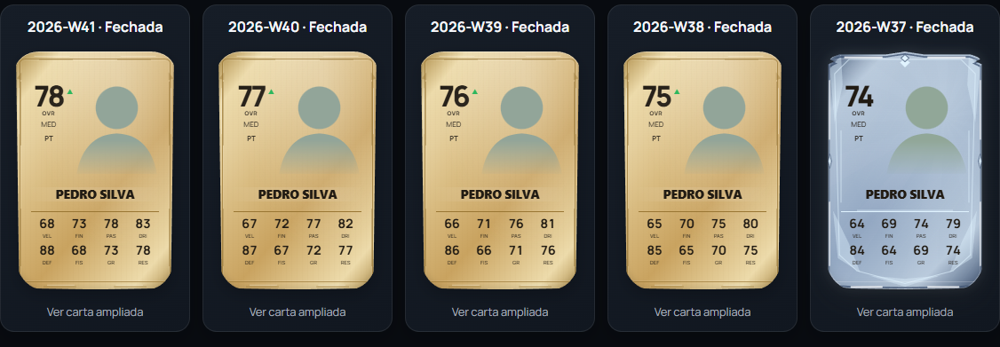

[Consultar as regras de cartas e OVR →](docs/reference/cards-and-ratings.md) · [Conhecer o cálculo de progressão →](docs/reference/progression.md)

## 04 · Jogos e equipas

### Consultar os encontros

A página de jogos apresenta data, local e estado de cada encontro. Os jogos finalizados mostram o resultado; os encontros abertos permitem consultar a preparação das equipas.

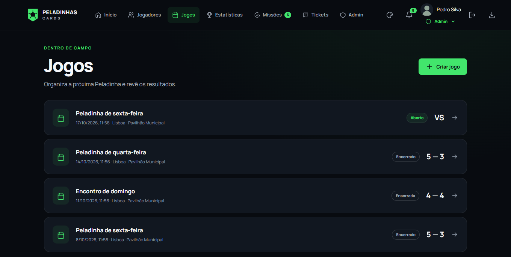

| Rascunho                           | Aberto                                              | Encerrado                                                  |
| :--------------------------------- | :-------------------------------------------------- | :--------------------------------------------------------- |
| Preparar os detalhes e as equipas. | Disponibilizar o encontro e gerir a sua composição. | Consultar resultado, contribuições e avaliações elegíveis. |

### Preparar o jogo

Os responsáveis definem título, data, hora de Lisboa e local. Podem associar um vídeo do YouTube e organizar as equipas manualmente ou através do sorteio equilibrado.

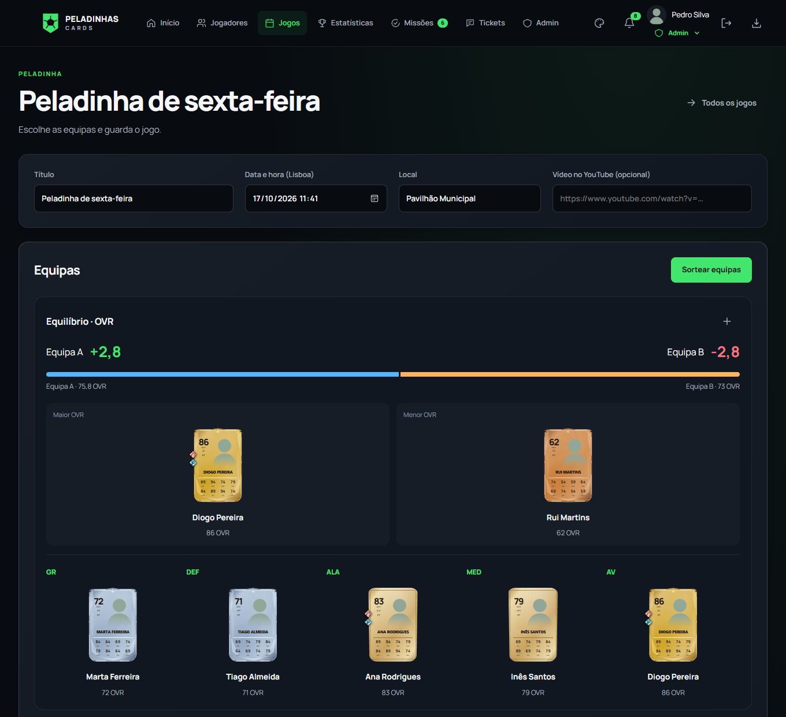

### Escolher jogadores e distribuir equipas

No sorteio, os jogadores são adicionados ao **balde de seleção**. A aplicação procura uma distribuição equilibrada com base no OVR e nas opções disponíveis. A organização pode ajustar a composição antes de guardar.

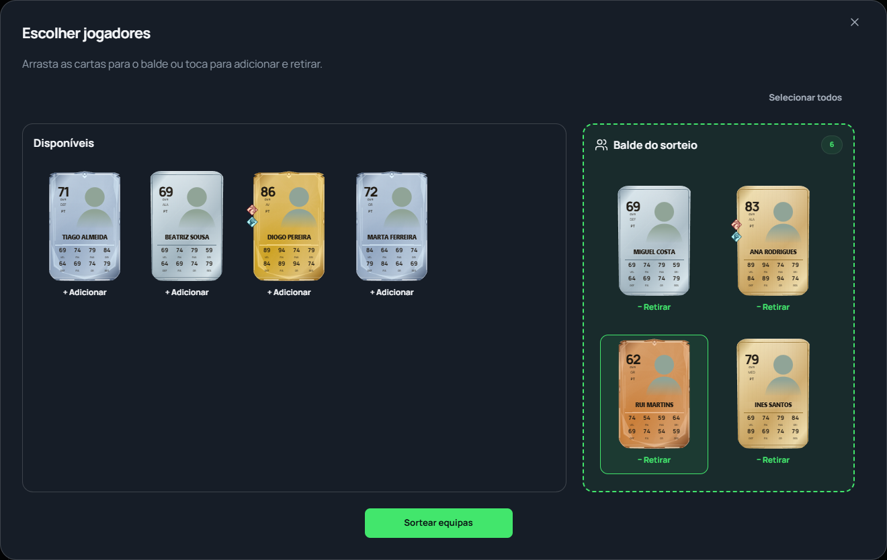

As equipas distinguem **titulares e suplentes**. Os controlos permitem mover jogadores entre grupos; o painel de equilíbrio compara as duas equipas e apresenta os valores de referência.

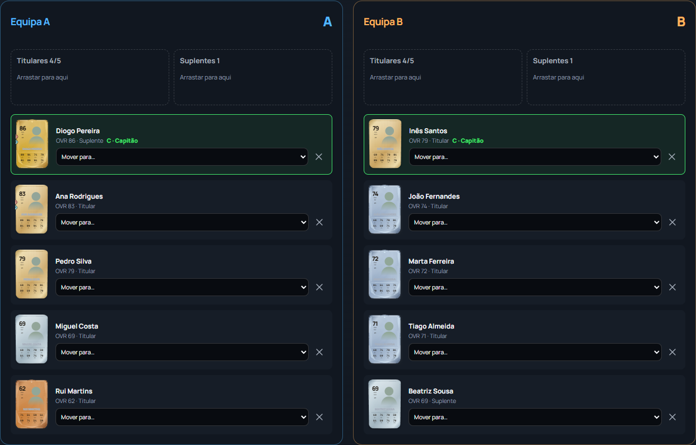

### Registar o resultado

O resultado inclui o marcador das duas equipas e os golos e assistências de cada participante. Depois do encerramento, esses registos alimentam as estatísticas e os objetivos elegíveis.

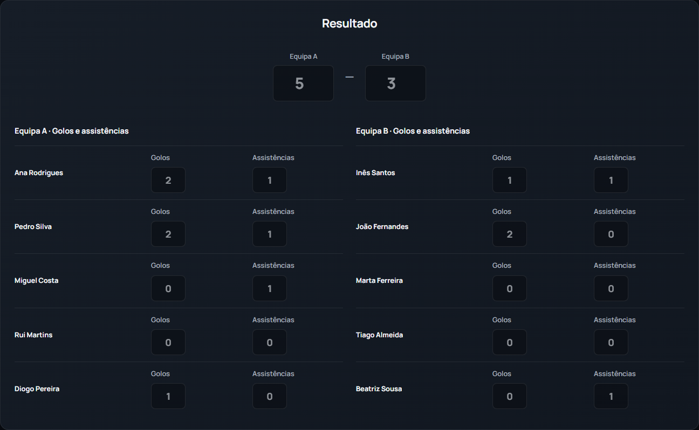

## 05 · Avaliações pós-jogo

Após um jogo encerrado, os participantes podem avaliar os colegas e o próprio desempenho. Os jogadores estão separados por equipa, com molduras azuis e laranja. Cada dimensão ocupa uma linha com cinco estrelas clicáveis, preenchidas da esquerda até à escolhida. Os rascunhos são guardados automaticamente.

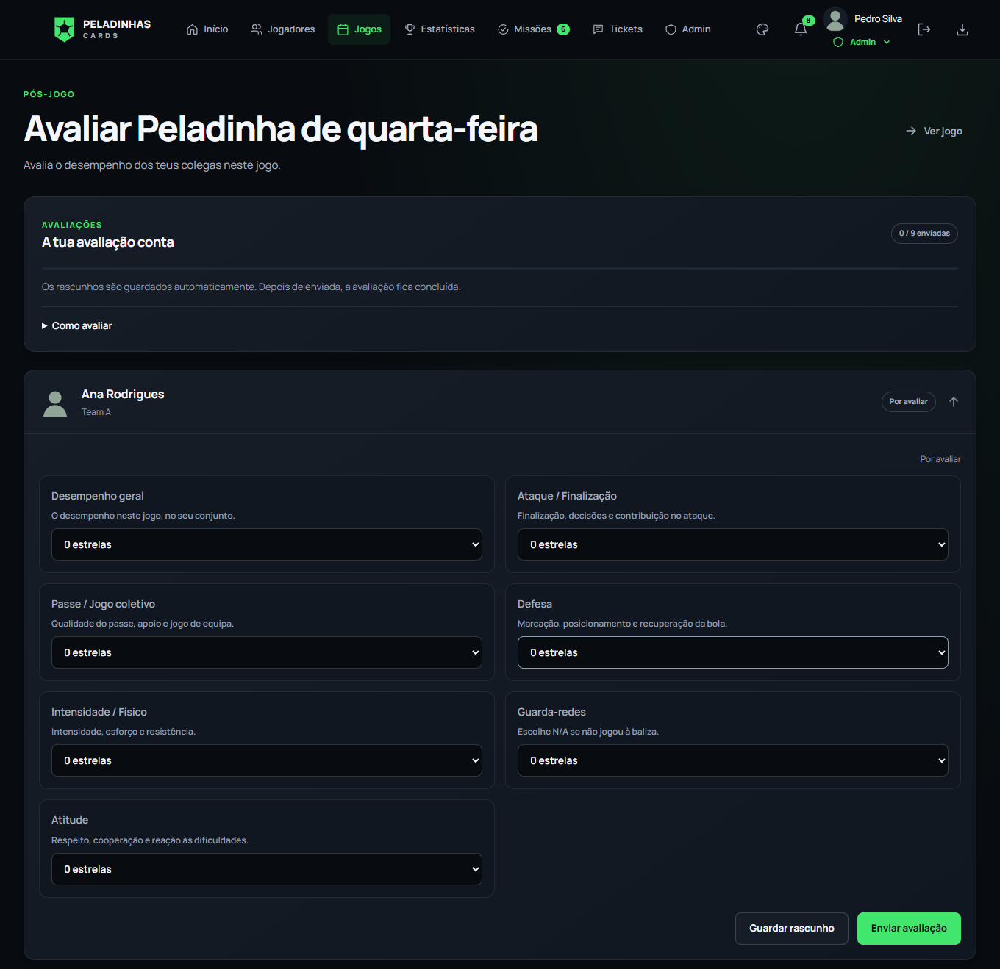

| Avaliar                                                              | Guardar                                     | Concluir                                    |
| :------------------------------------------------------------------- | :------------------------------------------ | :------------------------------------------ |
| Tocar nas estrelas para escolher de 1 a 5, ou selecionar 0 estrelas. | Os rascunhos são guardados automaticamente. | Enviar a avaliação quando estiver completa. |
| Escolher «Não jogou à baliza» quando não aplicável.                  | Retomar as avaliações ainda por enviar.     | As avaliações submetidas ficam concluídas.  |

Os restantes membros consultam os agregados permitidos. As respostas individuais não são mostradas aos outros jogadores; a administração tem acesso de revisão.

A autoavaliação pós-jogo tem o mesmo peso de cada avaliação externa. Se o jogador submeter **Não jogou à baliza**, guarda-redes passa a não aplicável para esse jogo: os colegas não podem atribuir uma nota numérica e notas anteriores desse critério não entram no agregado. A restrição é aplicada pelo formulário, regras Firestore e servidor.

## 06 · Estatísticas e ranking

### Comparar a liga

Os indicadores resumem a atividade da comunidade. A tabela permite comparar e ordenar os jogadores por OVR, forma, participação, resultados, golos e assistências.

| Participação   | Resultados                            | Contribuições                          |
| :------------- | :------------------------------------ | :------------------------------------- |
| Jogos e forma. | Vitórias, empates e derrotas.         | Golos e assistências.                  |
| OVR e posição. | Taxa de vitória e diferença de golos. | Golos marcados e sofridos pela equipa. |

O **ranking semanal** destaca o desempenho do ciclo. Exige avaliações suficientes para a forma semanal e utiliza o OVR como desempate ou referência quando faltam dados.

## 07 · Missões

As missões reúnem as avaliações por concluir e os objetivos ativos. Cada entrada indica o que falta fazer, a quantidade atingida e a percentagem de progresso.

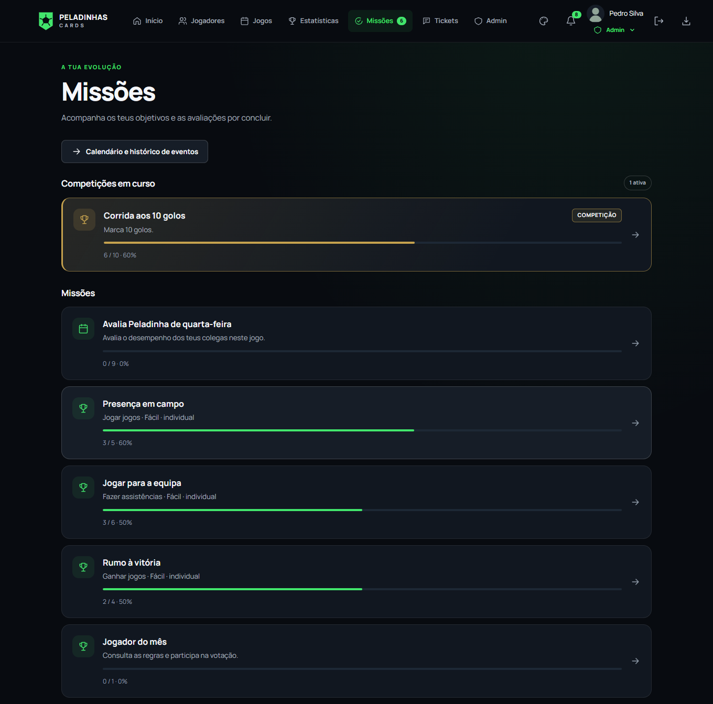

- **Participação:** jogar um determinado número de encontros.
- **Contribuições:** marcar golos, fazer assistências ou combinar ambos.
- **Resultados:** conquistar vitórias ou cumprir sequências.
- **Desbloqueio:** disponibilizar uma missão após concluir outras.

Os objetivos podem ser individuais ou coletivos, com prazo, periodicidade e limites de conclusão configuráveis. O servidor verifica os registos dos jogos antes de autorizar a recompensa.

### Escolhe o teu caminho!

São 12 especializações e três fusões, com [120 modelos de missão](docs/reference/path-mission-catalogue.md) para o **próximo jogo**. O resumo mostra a missão escolhida, o nó, o progresso, o avanço possível e a recompensa; sem escolha, mantém a apresentação simples. No percurso, o objetivo fica destacado num bloco compacto com a raridade da missão, recompensas integradas e ações claras. **+100% de avanço** e **+1 no atributo** representam coisas diferentes: o ponto é entregue ao completar o nó. [Funcionamento e regras](docs/reference/player-paths.md) · [Validação local](docs/reports/path-interface-2026-10-19.md).

## 08 · Eventos e competições

O calendário reúne os eventos ativos, agendados e terminados. Os filtros permitem pesquisar por nome, estado, tipo e data; os detalhes de cada evento apresentam as regras e a participação aplicável.

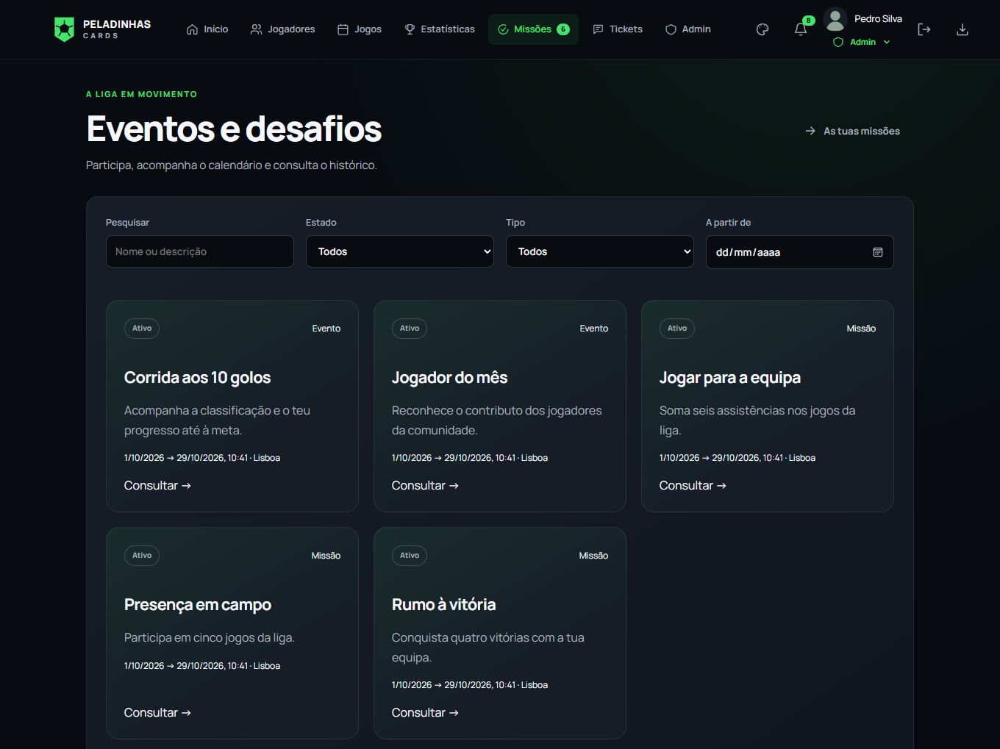

| Formato                     | Participação                           | Resultado                                            |
| :-------------------------- | :------------------------------------- | :--------------------------------------------------- |
| **Missão**                  | Cumprir um objetivo.                   | Cada participante elegível pode concluir e reclamar. |
| **Competição por objetivo** | Atingir uma meta.                      | As posições seguem a ordem de conclusão.             |
| **Votação**                 | Escolher candidatos elegíveis.         | Apuramento segundo as regras do evento.              |
| **Competição controlada**   | Classificação gerida pela organização. | Ordem de vencedores definida no ADMIN.               |

As recompensas podem incluir Stats temporárias ou permanentes e cartas semanais. Participantes, posições premiadas, desempates e confirmação são definidos pela administração.

[Consultar objetivos, limites e recompensas →](docs/reference/events-and-missions.md)

**Escolhe o teu caminho!** tem uma divisão própria em Missões e acesso no teu perfil: escolhe entre três desafios para o próximo jogo, ativa uma especialização, descobre fusões com três focos e conquista cartas permanentes. Limites próprios de +15 por atributo e +25 em Guarda-redes, independentes das outras recompensas. [Ver funcionamento →](docs/reference/player-paths.md)

## 09 · Administração

A área de administração concentra as ferramentas de gestão e uma visão geral do estado da liga. O menu próprio permite alternar entre jogadores, jogos, avaliações, eventos e configuração das cartas.

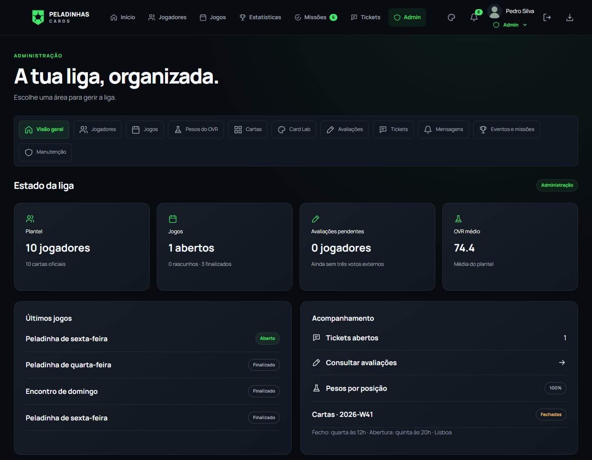

| Área de gestão          | Principais operações                                            |
| :---------------------- | :-------------------------------------------------------------- |
| **Jogadores e acessos** | Editar perfis, atribuir papéis e rever o estado das cartas.     |
| **Jogos**               | Criar, gerir equipas, encerrar e consultar encontros.           |
| **Avaliações e OVR**    | Rever avaliações, pesos por posição e cálculo dos valores.      |
| **Eventos e missões**   | Criar objetivos, gerir participantes, resultados e recompensas. |
| **Cartas**              | Trabalhar estilos no Card Lab e gerir recursos visuais.         |
| **Comunicação e apoio** | Enviar mensagens e responder aos tickets da comunidade.         |
| **Manutenção**          | Recalcular cartas em evolução, preservando semanas fechadas.    |

**Papéis:** o membro participa na liga; o DBS gere os jogos permitidos; o administrador gere a configuração e as restantes áreas protegidas. As permissões são verificadas no servidor.

## 10 · Card Lab e temas

### Composição de cartas

O Card Lab permite à administração trabalhar a apresentação das cartas com pré-visualização. Inclui modelos, camadas, paletas, molduras, fontes, efeitos e fotografia, com composições guardadas e importação/exportação JSON.

### Ambientes da interface

| Club Original          | Volt Arena               | Champions Night          | Ultimate 20               |
| :--------------------- | :----------------------- | :----------------------- | :------------------------ |
| Preto azulado e verde. | Violeta profundo e lima. | Azul meia-noite e ciano. | Cinzento, rosa e dourado. |

A escolha do tema acompanha a interface e a cor do browser. Os estilos das cartas são geridos separadamente.

A [referência do Card Lab](docs/reference/card-lab.md) descreve a bancada atual: oito ferramentas, galerias com nomes próprios, 50 paletas vibrantes, fotografia do ADMIN, iluminação dirigida, remoção integral do traçado, projetos e compatibilidade com composições antigas.

## 11 · Apoio e mensagens

### Pedidos de apoio

Os tickets mantêm o pedido e as respostas numa conversa própria. Permitem acompanhar dúvidas e correções sem perder o contexto. Um ticket fechado fica no histórico e não pode ser reaberto.

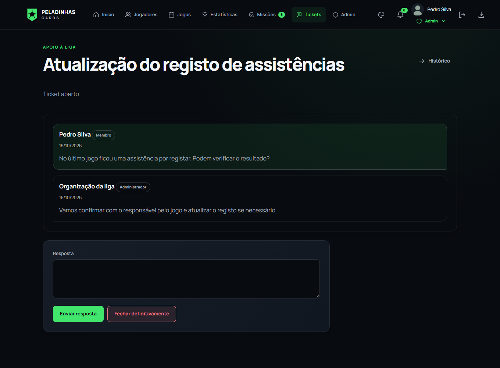

### Notificações da liga

A caixa de notificações separa **Por ler** e **Histórico**. As mensagens podem dar acesso direto a um jogo, missão ou outra área relacionada. Ao ler, a notificação deixa a lista principal e fica guardada no histórico.

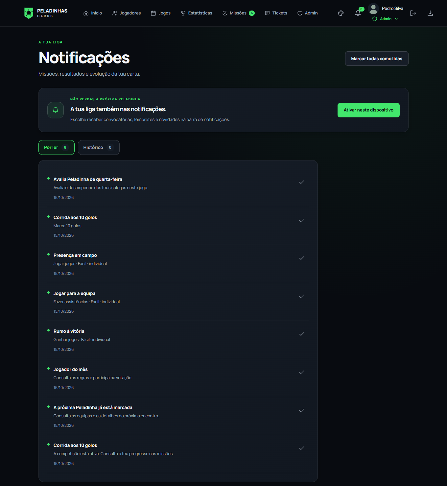

A integração Web Push permite alertas do sistema após ativação no dispositivo. O toque no alerta fecha-o e confirma a leitura; sem rede, essa confirmação fica em fila local. A entrega depende do suporte, das permissões e da configuração do servidor.

[Consultar ativação, funcionamento e estado de configuração do push →](docs/guides/notifications.md)

No início em telemóvel, quem ainda não ativou alertas recebe o convite **A tua liga chama por ti.** O popup inicia a ativação apenas ao tocar no botão; **Agora não** adia o convite sete dias. Permissões bloqueadas e instalação necessária no iPhone têm orientação própria. O histórico interno e o alerta nativo continuam a usar o mesmo registo.

## 12 · Mobile e instalação

### Navegação adaptada ao telemóvel

A navegação inferior dá acesso a **Início, Jogadores, Jogos e Missões**. O menu **Mais** reúne perfil, estatísticas, ranking, eventos, apoio e instalação; a administração surge para as contas autorizadas.

<table>
<tr>
<td width="33%" align="center" valign="top">
<strong>Menu Mais</strong>  
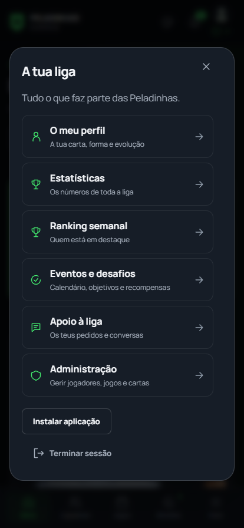
</td>
<td width="33%" align="center" valign="top">
<strong>Jogos</strong>  
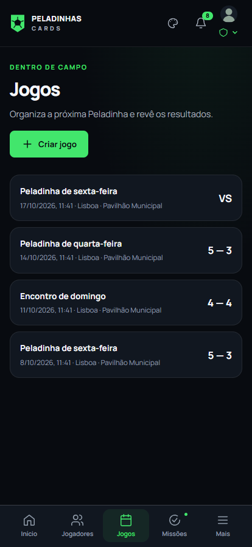
</td>
<td width="33%" align="center" valign="top">
<strong>Estatísticas</strong>  
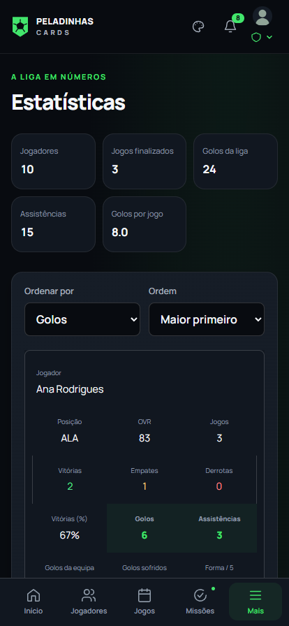
</td>
</tr>
</table>

### Instalar a aplicação

O website pode ser instalado como **PWA**, com ícone no dispositivo e abertura numa janela própria. O início apresenta os acessos de instalação e as instruções adequadas a cada plataforma.

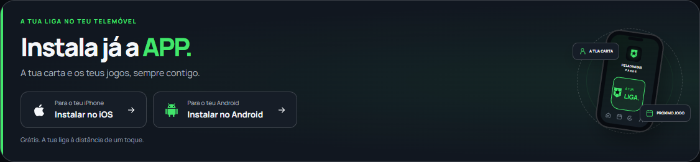

| Plataforma / situação | Experiência                                                                       |
| :-------------------- | :-------------------------------------------------------------------------------- |
| **Android**           | Pedido de instalação quando disponível; alternativa pelo menu do browser.         |
| **iPhone**            | Safari → Partilhar → Adicionar ao ecrã principal.                                 |
| **Nova versão**       | Opção de atualizar ou adiar, sem interromper automaticamente formulários.         |
| **Sem ligação**       | Ecrã de recuperação; consultar dados da liga e guardar alterações exige Internet. |

A PWA utiliza o mesmo frontend e Firebase do website. A instalação atual não gera APK/IPA nem publica nas lojas.

[Conhecer a instalação, o cache e as atualizações →](docs/guides/pwa.md)

## Documentação técnica

O frontend utiliza **HTML, CSS e JavaScript com ES Modules**. O Firebase suporta autenticação, Firestore, Storage e processamento em Cloud Functions. Os procedimentos técnicos e as regras detalhadas ficam nos documentos abaixo.

| Desenvolvimento e operação                                    | Regras e funcionalidades                                                |
| :------------------------------------------------------------ | :---------------------------------------------------------------------- |
| [Desenvolvimento local](docs/guides/development.md)           | [Cartas, avaliações e OVR](docs/reference/cards-and-ratings.md)         |
| [Arquitetura e estrutura](docs/reference/architecture.md)     | [Progressão por jogo](docs/reference/progression.md)                    |
| [Testes e validação](docs/guides/testing.md)                  | [Eventos, missões e recompensas](docs/reference/events-and-missions.md) |
| [Publicação no Firebase](docs/guides/deployment.md)           | [PWA e instalação](docs/guides/pwa.md)                                  |
| [Repositório e migração](docs/guides/repository-migration.md) | [Notificações do telemóvel](docs/guides/notifications.md)               |
| [Recursos de design](design/README.md)                        | [Interface e validação dos percursos](docs/reports/path-interface-2026-10-19.md)             |

[Consultar o índice completo →](docs/README.md)

---

**Peladinhas Cards**

[Aplicação ↗](https://pedalinhas-cards.web.app/) &nbsp; · &nbsp; [Documentação](docs/README.md) &nbsp; · &nbsp; [Voltar ao início ↑](#o-projeto)

## Manutenção do sistema

[Configurações, operações, segurança e recuperação](docs/reference/maintenance.md).
