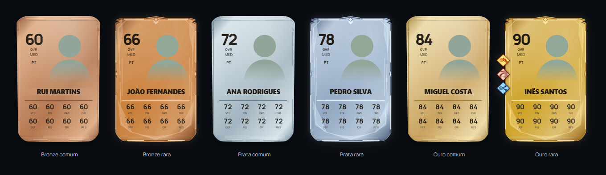
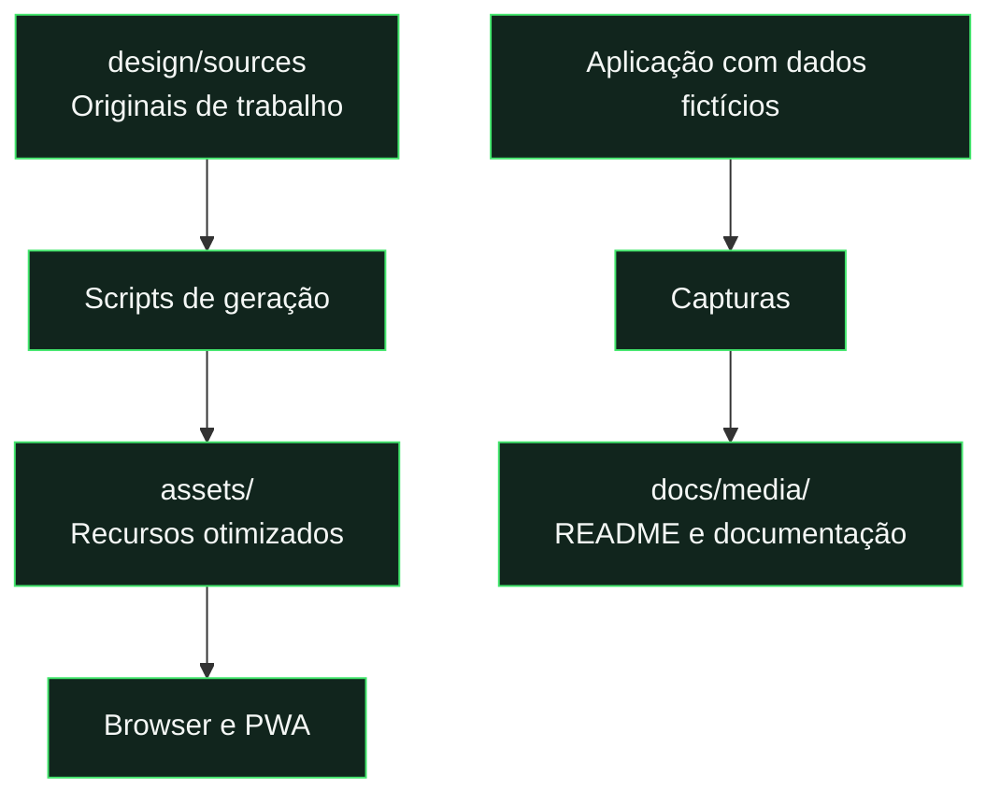
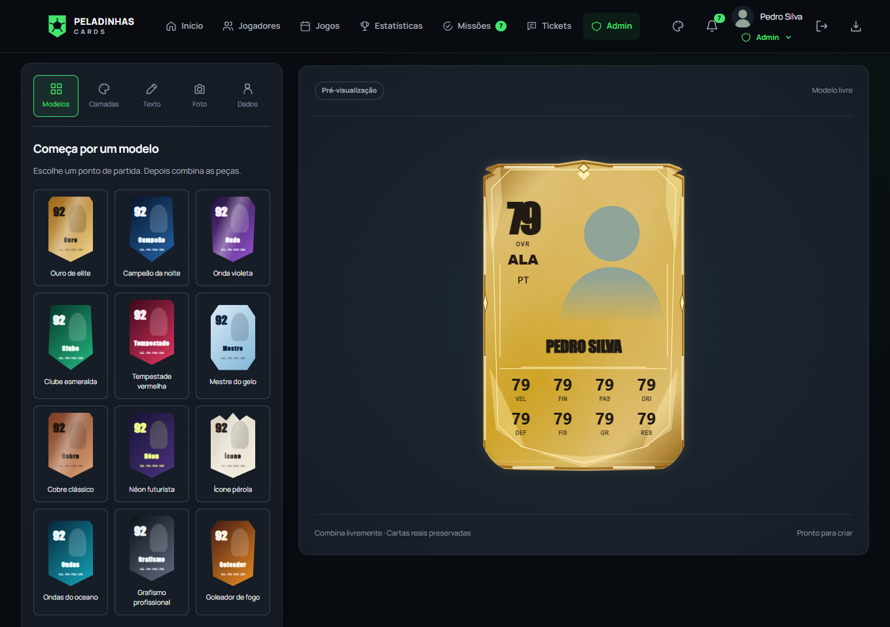

# Recursos de design

[← Documentação](../docs/README.md) · [Apresentação do projeto](../README.md)



## Originais e ficheiros públicos



| Pasta             | Conteúdo                               | Vai para Hosting? |
| :---------------- | :------------------------------------- | :---------------: |
| `design/sources/` | PNG originais e fonte variável TTF.    |        Não        |
| `assets/`         | WebP, WOFF, logótipo e ícones PWA.     |        Sim        |
| `docs/media/`     | Banner SVG e capturas de demonstração. |        Não        |

## Playstyles

<table>
<tr>
<td align="center"><br />Velocidade</td>
<td align="center"><br />Finalização</td>
<td align="center"><br />Passe</td>
<td align="center"><br />Drible</td>
</tr>
<tr>
<td align="center"><br />Defesa</td>
<td align="center"><br />Físico</td>
<td align="center"><br />Guarda-redes</td>
<td align="center"><br />Resistência</td>
</tr>
</table>

**Oito PNG: mais de 7 MB → oito WebP: cerca de 107 KB.** Os derivados têm no máximo 256 px.

## Fontes e identidade

| Elemento   | Fonte de trabalho                    | Distribuído na aplicação            |
| :--------- | :----------------------------------- | :---------------------------------- |
| Manrope    | `sources/fonts/manrope-variable.ttf` | WOFF nos pesos 400, 600, 700 e 800. |
| Playstyles | `sources/playstyles/*.png`           | WebP otimizados.                    |
| Emblema    | [Logótipo SVG](../assets/logo.svg)   | Ícones PNG, maskable e Apple touch. |

A licença Manrope acompanha os ficheiros: [OFL-Manrope.txt](../assets/fonts/OFL-Manrope.txt).

## Regenerar recursos

Executar **na raiz do projeto**. Expandir apenas o recurso que queres alterar.

<details>
<summary><strong>Playstyles → WebP</strong></summary>

```powershell
node scripts/optimize-playstyles.mjs
```

Usa Playwright para converter os originais. Conserva os PNG em `design/sources/playstyles/`.

</details>

<details>
<summary><strong>Manrope → WOFF</strong></summary>

```powershell
python -m pip install -r design/requirements.txt
python scripts/generate-fonts.py
```

Requer Python e `fonttools`. Rever os quatro pesos utilizados pela interface.

</details>

<details>
<summary><strong>Logótipo → ícones PWA</strong></summary>

```powershell
node scripts/generate-pwa-icons.mjs
```

Usa Playwright. Verificar ícones normais, maskable e Apple touch antes de publicar.

</details>

<details>
<summary><strong>Aplicação → capturas da documentação</strong></summary>

```powershell
npm.cmd run docs:images
npm.cmd run test:docs
```

Gera painel desktop, mobile, estatísticas, Card Lab e galeria. Usa a aplicação real com autenticação e dados simulados; não consulta contas de produção.

</details>

## Interface e ilustração em código

Os ícones específicos dos menus do Card Lab estão em `js/icons.js`; a estrutura e as animações das expansões estão em `js/card-lab-interface.js` e `css/card-lab.css`. O convite de notificações usa ilustração HTML/CSS em `js/push.js` e `css/experience.css`, sem novos bitmaps.

DIN Pro Condensed Regular/Medium/Bold e Posterama 1927 Bold são referências locais do navegador, não fontes incluídas neste repositório. Sem instalação local são usadas as alternativas do catálogo. A interface geral continua a distribuir Manrope.

## Card Lab



**Modelos · Composição · Cores · Materiais · Símbolos · Texto · Foto · Projetos**

A carta mantém-se visível enquanto se usam os menus, com scroll dentro da ferramenta. A fotografia é sempre a do ADMIN autenticado. Há 50 paletas, iluminação configurável e traçado removível; consultar a [referência funcional](../docs/reference/card-lab.md). O Card Lab gere composições dentro da aplicação. Os scripts acima gerem os ficheiros estáticos do repositório.
