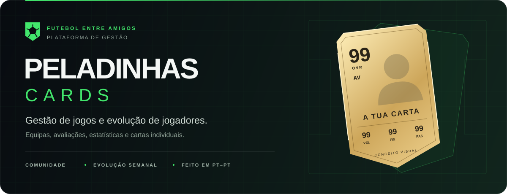
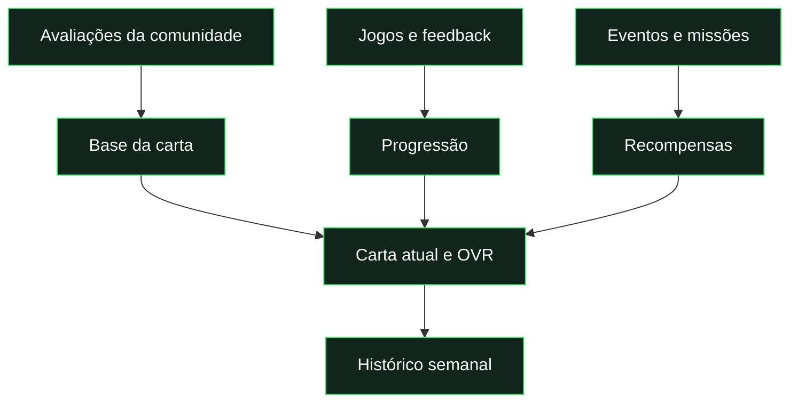

# Documentação

**Escolhe um objetivo. Consulta o resumo. Expande os detalhes quando precisares.**

[← Projeto](../README.md) · [Aplicação ↗](https://pedalinhas-cards.web.app/)

[Novos critérios das cartas e mínimo de sete avaliações — 21/10/2026](reports/card-criteria-2026-10-21.md).

[Início atualizado e recuperação horária com menos leituras — 21/10/2026](reports/home-read-cache-2026-10-21.md) · [Funcionamento](reference/home-data.md).

## Por onde começar

[Como as tuas estatísticas mudam: guia em Jogadores e progressão versionada — 26/10/2026](reports/progression-guide-implementation-2026-10-26.md).

[Casino, Djabucoin e integração da slot](guides/casino.md) · [Validação local de 24/10/2026](reports/casino-2026-10-24.md).

[Carteira local sem chamadas por spin — 25/10/2026](reports/casino-local-2026-10-25.md).

[Manutenção por páginas, horários semanais e histórico de alterações — 22/10/2026](reports/maintenance-pages-2026-10-22.md).

[Missões concluídas: destaque e resgate na própria caixa — 22/10/2026](reports/mission-completion-2026-10-22.md).

[Anular votos em falta: mínimos sem alterar médias — 22/10/2026](reports/rating-waivers-2026-10-22.md).

[Performance: jogos entre fechos semanais — 22/10/2026](reports/performance-week-2026-10-22.md).

[Sucata: carta base até 49 OVR — 22/10/2026](reports/scrap-card-2026-10-22.md).

[Ultimate 20: cores, contraste e validação em desktop/telemóvel](reports/ultimate-theme-2026-10-21.md).

[Avaliações processadas apenas quando há alterações, hora a hora](reference/feedback-processing.md) · [Validação de 21/10/2026](reports/feedback-hourly-2026-10-21.md).

[Diagnóstico de permissões nas avaliações da app](reports/feedback-mobile-access-2026-10-19.md).

[Explorar estatísticas e construir consultas](reference/statistics.md) · [Validação da nova tabela](reports/statistics-explorer-2026-10-19.md).

[Autoavaliação sem GR: correção histórica e validação](reports/goalkeeping-optout-2026-10-19.md).

[QuestETC — atualizar missões, raridades e alvos](../QuestETC.md) · [Procedimento técnico](guides/path-calibration.md) · [Análise de golos de 19/10/2026](reports/path-goal-calibration-2026-10-19.md).

[Ultimate ETC: dificuldade superior à Ícone — 21/10/2026](reports/path-ultimate-2026-10-21.md).

[Cinco fusões por posição: missões, cartas e publicação — 21/10/2026](reports/path-position-fusions-2026-10-21.md).

[Fecho semanal à quarta-feira às 18h e reabertura da semana corrente](reports/weekly-close-18-2026-10-21.md).

| Quero trabalhar no projeto                           | Quero perceber o produto                                 | Quero publicar                                  |
| :--------------------------------------------------- | :------------------------------------------------------- | :---------------------------------------------- |
| [1. Preparar o ambiente](guides/development.md)      | [1. Cartas e avaliações](reference/cards-and-ratings.md) | [1. Escolher os testes](guides/testing.md)      |
| [2. Conhecer a estrutura](reference/architecture.md) | [2. Evolução por jogo](reference/progression.md)         | [2. Publicar no Firebase](guides/deployment.md) |
| [3. Validar alterações](guides/testing.md)           | [3. Missões e eventos](reference/events-and-missions.md) | [3. Confirmar nos aparelhos](guides/pwa.md)     |

## Como os conceitos se ligam

| Conceito       | Leitura rápida                             | Referência                                            |
| :------------- | :----------------------------------------- | :---------------------------------------------------- |
| **Carta**      | Identidade, posição e atributos.           | [Cartas e OVR](reference/cards-and-ratings.md)        |
| **Progressão** | Como os jogos alteram os atributos.        | [Evolução por jogo](reference/progression.md)         |
| **Missão**     | Um objetivo a cumprir.                     | [Eventos e missões](reference/events-and-missions.md) |
| **PWA**        | A aplicação web instalada no dispositivo.  | [Instalação e offline](guides/pwa.md)                 |
| **Push**       | Um alerta enviado ao sistema do telemóvel. | [Notificações](guides/notifications.md)               |

## Desenvolvimento e operação

[Redução das leituras do Firestore](reports/firestore-read-reduction-2026-10-19.md): isolamento do desenvolvimento, diagnósticos reutilizáveis e otimização de missões, recálculos e automações. Implementação local de 19/10/2026, sem publicação. [Procedimento de diagnósticos](guides/firestore-read-diagnostics.md).

| Documento                                      | Encontrar aqui                                         |
| :--------------------------------------------- | :----------------------------------------------------- |
| [Desenvolvimento local](guides/development.md) | Requisitos, arranque e configuração Firebase.          |
| [Arquitetura](reference/architecture.md)       | Pastas, módulos, dados e permissões.                   |
| [Testes](guides/testing.md)                    | Comandos por tipo de alteração e limites da automação. |
| [Publicação](guides/deployment.md)             | Frontend, servidor, regras e confirmação após deploy.  |
| [PWA](guides/pwa.md)                           | Instalação, cache, offline e atualizações.             |
| [Notificações](guides/notifications.md)        | Ativação, envio, leitura e configuração VAPID.         |
| [Repositório](guides/repository-migration.md)  | Localização atual, GitHub e cópias limpas.             |

## Alterações e operação atuais

- [Catálogo de missões dos percursos](reference/path-mission-catalogue.md): 255 modelos, objetivos combinados e sorteio com menos repetição; implementação local, com [validação e publicação seletiva](reports/path-expansion-2026-10-20.md). Metas provisórias; ainda sem deploy.
- [Escolhe o teu caminho!](reference/player-paths.md): percursos pessoais, missões para o próximo jogo e cartas permanentes; [interface compacta e validação](reports/path-interface-2026-10-19.md).
- [Update de Escolhe o teu caminho!](reports/path-update-2026-10-18.md): caminho ativo, fusões desbloqueáveis, reroll diário global, sete votos por critério e dificuldade final desde +10; implementação local concluída, com [validação e publicação seletiva](reports/path-update-2026-10-18.md).
- [Card Lab](reference/card-lab.md): ferramentas, paletas, luz, traçado e projetos.
- [Avaliações](reference/cards-and-ratings.md): guarda-redes N/A determinado pela autoavaliação submetida e comparação semanal apenas com valores permanentes.
- [Publicação por âmbito](guides/deployment.md): frontend, consumidores de módulos partilhados, regras e confirmação após publicação.
- [Notificações](guides/notifications.md): convite móvel, permissão voluntária e diagnóstico VAPID sem expor segredos.

As capturas usam dados fictícios. O [relatório de interface dos percursos](reports/path-interface-2026-10-19.md) distingue testes, alterações cloud e publicação; consultar os guias para os procedimentos correntes.

## Design e imagens

| Recurso                                | Onde                                      |
| :------------------------------------- | :---------------------------------------- |
| Originais, fontes e otimização         | [Recursos de design](../design/README.md) |
| Banner e capturas da aplicação         | [Imagens da documentação](media/)         |
| Regenerar capturas com dados fictícios | `npm.cmd run docs:images`                 |

## Registo de revisão

[Correção dos objetivos dos percursos - 20/10/2026](reports/path-objectives-2026-10-20.md).

[Construtor de metas e preservação do progresso — 19 de outubro de 2026](reports/goal-builder-2026-10-19.md).

[Totais históricos para missões e eventos — 19 de outubro de 2026](reports/historical-objectives-2026-10-19.md).

[Resultados e estrelas em objetivos combinados — 19 de outubro de 2026](reports/combined-objectives-2026-10-19.md).

[Recuperação de passwords com código — 19 de outubro de 2026](reports/password-recovery-2026-10-19.md).

[Revisão da interface dos percursos — 19 de outubro de 2026 →](reports/path-interface-2026-10-19.md)

Regista alterações e validações realizadas. O estado de publicação e as limitações devem ser confirmados nos guias; um teste local não comprova a entrega push num aparelho.

## Manutenção do sistema

[Configurações, operações, segurança e recuperação](reference/maintenance.md).

## Estado dos documentos

Guias e referências descrevem o código local; relatórios conservam resultados datados. Não se confirma publicação a partir de capturas ou de comandos escritos. Os antigos planos de `docs/plans/` e alguns relatórios já não estão nesta cópia; o catálogo atual foi documentado a partir do código, sem inventar os documentos ausentes.
