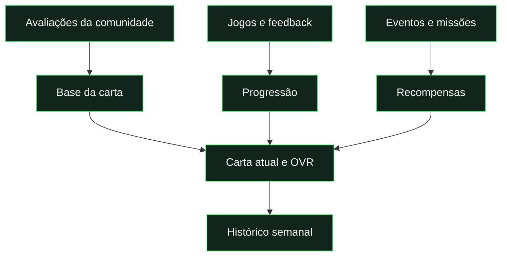

# Documentação

**Escolhe um objetivo. Consulta o resumo. Expande os detalhes quando precisares.**

[← Projeto](../README.md) · [Aplicação ↗](https://pedalinhas-cards.web.app/)

## Por onde começar

| Quero trabalhar no projeto                           | Quero perceber o produto                                 | Quero publicar                                  |
| :--------------------------------------------------- | :------------------------------------------------------- | :---------------------------------------------- |
| [1. Preparar o ambiente](guides/development.md)      | [1. Cartas e avaliações](reference/cards-and-ratings.md) | [1. Escolher os testes](guides/testing.md)      |
| [2. Conhecer a estrutura](reference/architecture.md) | [2. Evolução por jogo](reference/progression.md)         | [2. Publicar no Firebase](guides/deployment.md) |
| [3. Validar alterações](guides/testing.md)           | [3. Missões e eventos](reference/events-and-missions.md) | [3. Confirmar nos aparelhos](guides/pwa.md)     |

## Como os conceitos se ligam

| Conceito       | Leitura rápida                             | Referência                                            |
| :------------- | :----------------------------------------- | :---------------------------------------------------- |
| **Carta**      | Identidade, posição e atributos.           | [Cartas e OVR](reference/cards-and-ratings.md)        |
| **Progressão** | Como os jogos alteram os atributos.        | [Evolução por jogo](reference/progression.md)         |
| **Missão**     | Um objetivo a cumprir.                     | [Eventos e missões](reference/events-and-missions.md) |
| **PWA**        | A aplicação web instalada no dispositivo.  | [Instalação e offline](guides/pwa.md)                 |
| **Push**       | Um alerta enviado ao sistema do telemóvel. | [Notificações](guides/notifications.md)               |

## Desenvolvimento e operação

| Documento                                      | Encontrar aqui                                         |
| :--------------------------------------------- | :----------------------------------------------------- |
| [Desenvolvimento local](guides/development.md) | Requisitos, arranque e configuração Firebase.          |
| [Arquitetura](reference/architecture.md)       | Pastas, módulos, dados e permissões.                   |
| [Testes](guides/testing.md)                    | Comandos por tipo de alteração e limites da automação. |
| [Publicação](guides/deployment.md)             | Frontend, servidor, regras e confirmação após deploy.  |
| [PWA](guides/pwa.md)                           | Instalação, cache, offline e atualizações.             |
| [Notificações](guides/notifications.md)        | Ativação, envio, leitura e configuração VAPID.         |
| [Repositório](guides/repository-migration.md)  | Localização atual, GitHub e cópias limpas.             |

## Design e imagens

| Recurso                                | Onde                                      |
| :------------------------------------- | :---------------------------------------- |
| Originais, fontes e otimização         | [Recursos de design](../design/README.md) |
| Banner e capturas da aplicação         | [Imagens da documentação](media/)         |
| Regenerar capturas com dados fictícios | `npm run docs:images`                     |

## Registo de revisão

[Revisão da experiência e PWA →](reports/experience-review.md)

Regista alterações e validações realizadas. O estado de publicação e as limitações devem ser confirmados nos guias; um teste local não comprova a entrega push num aparelho.
