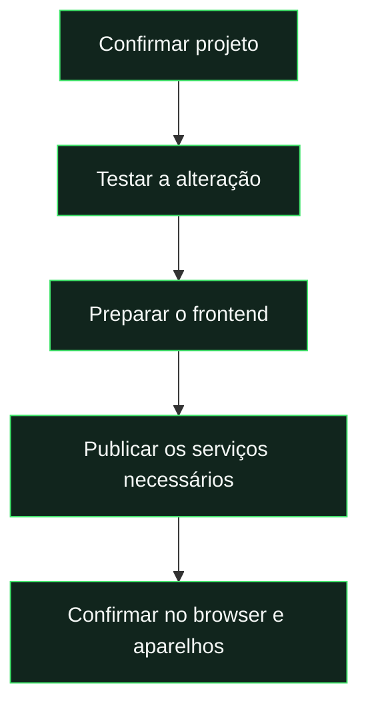

# Publicação

[← Documentação](../README.md) · [Testes](testing.md) · [PWA](pwa.md) · [Push](notifications.md)

## O que queres publicar?

| Alteração                 | Comando                       | Publica                          |
| :------------------------ | :---------------------------- | :------------------------------- |
| Só interface              | `npm.cmd run deploy:frontend` | Hosting e PWA.                   |
| Servidor ou permissões    | `npm.cmd run deploy:backend`  | Functions, regras e índices.     |
| Atualização completa      | `npm.cmd run deploy`          | Frontend, servidor e regras.     |
| Apenas preparar ficheiros | `npm.cmd run build:hosting`   | **Nada:** gera `.firebase/site`. |

**Projeto:** `pedalinhas-cards` · **Aplicação:** [pedalinhas-cards.web.app](https://pedalinhas-cards.web.app/)



## Conferência rápida

- [ ] Configuração Firebase e conta de publicação corretas.
- [ ] Testes adequados à alteração concluídos.
- [ ] Fluxos e layouts revistos no browser.
- [ ] Após deploy: conta, dados, fotografias e ações principais.
- [ ] Em mobile: instalação, atualização e recuperação sem rede.

> **Push exige configuração própria.** Um deploy só do frontend não corrige a chave VAPID nem atualiza as Functions. Consultar [notificações](notifications.md).

---

<details>
<summary><strong>Procedimentos completos e detalhes técnicos</strong></summary>

## Projeto configurado

O ID existente é **`pedalinhas-cards`**. Os scripts leem `js/config.js` e usam `--project` explicitamente; não dependem de um alias ativo. Confirmar a configuração antes de publicar uma instalação diferente.

Organizar ficheiros, preparar o build ou exportar o repositório não publica a aplicação.

## Preparar

Com Node.js 22, na raiz:

```powershell
npm.cmd ci
npx.cmd firebase login --reauth
npm.cmd run check
npm.cmd test
npm.cmd run test:docs
npm.cmd run test:pwa
```

Alterações de servidor/regras pedem os respetivos testes com emulador. Alterações de interface pedem revisão dos fluxos no browser. Ver [testes e validação](testing.md).

## Primeira publicação com push

O frontend e as novas Functions têm de usar o mesmo par VAPID. Nesta pasta, o par já existe: pública em `js/push-config.js`, privada em `.secret.local`. Uma cópia exportada não contém a privada; recuperá-la de forma segura antes destes comandos.

```powershell
npm.cmd run setup:push:cloud
npm.cmd run deploy
```

`setup:push:cloud` verifica o par e guarda `WEB_PUSH_PRIVATE_KEY` no Firebase Secret Manager. Exige autenticação e permissões no projeto. Não regenerar chaves depois de haver dispositivos subscritos. O [guia de push](notifications.md) explica as Functions e a proteção dos recibos de leitura.

O projeto precisa dos serviços e plano necessários à instalação de Cloud Functions/Storage. Confirmar na consola Firebase; um erro de IAM deve ser resolvido segundo o serviço e conta indicados, sem concessões gerais inventadas.

## Publicar e atualizar

```powershell
npm.cmd run deploy
```

Verifica sintaxe e lógica, e publica **Hosting, regras/índices Firestore, Storage e Functions**. Não é necessário executar `firebase init` numa cópia com estas configurações.

Para mudanças exclusivamente de interface, com servidor/regras já atualizados:

```powershell
npm.cmd run deploy:frontend
```

Para servidor e regras:

```powershell
npm.cmd run deploy:backend
```

`deploy:frontend` sozinho não ativa push novo. Os scripts não substituem a validação nos aparelhos nem confirmam o estado do Firebase real.

## Pacote Hosting

`build:hosting` recria `.firebase/site` com entradas web, `js/`, `css/`, `assets/`, manifest, worker e página offline. Calcula o hash e inventário de cache da PWA. Documentação, fontes de trabalho, testes, ferramentas, servidor e segredos ficam de fora.

O Hosting permite revalidação HTTP. A aplicação instalada oferece ativar a nova versão; não interrompe um formulário automaticamente. Ver [PWA](pwa.md).

Depois de um deploy bem-sucedido, a URL configurada é `https://pedalinhas-cards.web.app`. Autorizar o domínio em Authentication → Settings → Authorized domains.

## GitHub Pages

Firebase Hosting e GitHub Pages são publicações independentes. Se mantiveres Pages, publicar o conteúdo de `.firebase/site` na raiz da demo e executar `deploy:backend` para atualizar Firebase. Publicar Hosting não altera a URL de Pages.

Uma nova origem/subpasta exige rever Authentication e origens push. A [mudança de repositório](repository-migration.md) identifica esses pontos.

## Confirmar depois de publicar

Verificar conta, fotografias, avaliações, tickets, jogos, estatísticas, OVR e histórico. Num update do cálculo, decidir se é necessário executar **Recalcular liga**, respeitando os snapshots preservados.

Em iPhone/Android, confirmar instalação, abertura pelo ícone, navegação, teclado, reabertura offline e atualização. Ativar push, enviar teste, fechar a app, tocar no alerta e confirmar leitura/histórico. A entrega Apple/Google e IAM só são confirmados em produção.

```powershell
npx.cmd firebase functions:list --project pedalinhas-cards
npx.cmd firebase hosting:sites:list --project pedalinhas-cards
```

O estado da execução local está no [relatório da revisão](../reports/experience-review.md).

</details>
