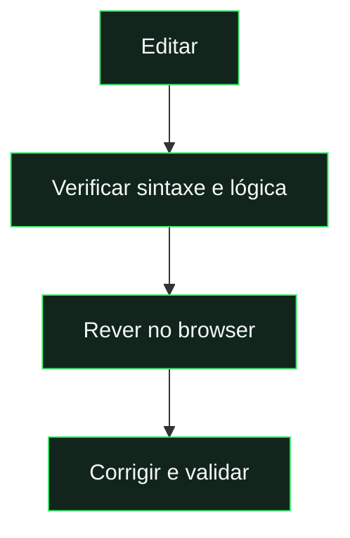

# Desenvolvimento local

[← Documentação](../README.md) · [Arquitetura](../reference/architecture.md) · [Testes](testing.md)

## Arranque rápido

| Requisito              | Quando é necessário                                          |
| :--------------------- | :----------------------------------------------------------- |
| **Node.js 22**         | Instalar dependências, executar scripts e servir o frontend. |
| **Java 21**            | Testes com emulador Firestore.                               |
| **Python + fonttools** | Apenas para regenerar fontes.                                |

```powershell
npm.cmd ci
npm.cmd run dev
```

**Abrir:** `http://localhost:8080` · **Outra porta:** `npm.cmd run dev -- --port 8081`



> **O arranque local usa fixtures por defeito.** `npm.cmd run dev` substitui autenticação, base e inicialização Firebase por dados locais. Não faz leituras Firestore. Para integração, usar os emuladores indicados abaixo.

| Guardar no Git                           | Manter local                                                     |
| :--------------------------------------- | :--------------------------------------------------------------- |
| Código, regras, documentação e lockfile. | `.secret.local`, dependências, builds, logs e capturas de teste. |

Os comandos usam `npm.cmd` no Windows; em macOS/Linux, usar `npm`.

---

<details>
<summary><strong>Procedimentos completos e detalhes técnicos</strong></summary>

## Ambiente

O projeto usa HTML, CSS e ES Modules diretamente no browser. Não precisa de um bundler para desenvolvimento. Os scripts e o servidor usam **Node.js 22**, conforme `package.json`. Os emuladores Firestore precisam de **Java 21** no ambiente usado pelo projeto. A geração de fontes é opcional e usa Python com `fonttools`.

Na raiz do projeto:

```powershell
npm.cmd ci
npm.cmd run dev
```

Abre `http://localhost:8080`. O servidor de desenvolvimento serve apenas os ficheiros públicos, incluindo os recursos PWA; não disponibiliza `.secret.local`, código de servidor ou documentação. A porta pode ser alterada com `npm.cmd run dev -- --port 8081`.

Em macOS/Linux, usa `npm` em vez de `npm.cmd`. Um servidor HTTP é necessário; abrir `index.html` com `file://` não carrega os módulos corretamente.

## Firebase

A configuração pública da Web App está em [`js/config.js`](../../js/config.js). A instalação existente aponta para **`pedalinhas-cards`**; a grafia do ID não é igual à do nome da aplicação. `.firebaserc` é a associação local e os scripts de publicação usam o ID da configuração explicitamente.

O servidor escolhe o modo sem alterar `js/config.js`:

| Comando | Dados e serviços |
| --- | --- |
| `npm.cmd run dev` | Fixtures locais; sem Firebase real. |
| `npm.cmd run emulators:dev`, seguido de `npm.cmd run dev:emulator` noutro terminal | Projeto `demo-peladinhas-development`: Auth 9099, Firestore 8085, Functions 5001 e Storage 9199, todos em `127.0.0.1`. |
| `npm.cmd run dev:production` | Escolha explícita de serviços reais e consumo real. Não usar para validar alterações visuais. |

Um emulador indisponível provoca erro local, sem fallback para produção. A integração exige um projeto `demo-`; pode ser necessário criar dados e contas no emulador. Um servidor genérico em localhost, sem modo explícito, é bloqueado antes da utilização Firebase. A versão publicada continua a usar a configuração real. Usar um perfil de browser separado e remover service workers antigos ao mudar de modo.

As fixtures de apoio são servidas por uma lista restrita; testes, Functions e credenciais continuam privados. O wrapper dos emuladores usa configuração CLI isolada, retira tokens do ambiente e desliga logs de depuração. Os testes Admin usam uma credencial sintética gerada localmente, válida apenas para o emulador.

Para diagnósticos reais, consultar [recolhas e redução de leituras](firestore-read-diagnostics.md). Sem `--live`, as auditorias reutilizam snapshots locais e não abrem o armazenamento de credenciais.

Para uma instalação independente:

1. Registar uma Web App no projeto Firebase e copiar a configuração para `js/config.js`.
2. Ativar Authentication com Email/Password e autorizar as origens utilizadas.
3. Preparar Firestore e Storage, e publicar regras, índices e Functions pelo [guia de publicação](deployment.md).
4. Criar a primeira conta pela aplicação; para iniciar a administração, definir `users/{uid}.role` como `admin` no Firestore e voltar a iniciar sessão.
5. Rever as origens push e o endpoint de confirmação antes de usar outro projeto ou domínio, conforme o [guia de migração](repository-migration.md).

O login apresenta username e password. O username é convertido internamente num email técnico em `auth.weeklyfc.app`; manter esse domínio numa instalação com contas existentes. Cliente e Functions usam `europe-west1`.

## Alterações que atravessam cliente e servidor

O cálculo de avaliações em `js/utils.js` é importado pelas Functions; alterar esse módulo exige rever os consumidores backend, não apenas o frontend. O esquema do Card Lab em `js/card-design.js` também é validado por `saveTheme` no servidor.

Depois de alterar a regra de guarda-redes, os resumos existentes precisam de **Administração → Manutenção → Recalcular liga** após a publicação. Novas autoavaliações submetidas são processadas por `onFeedback`; cartas de semanas fechadas mantêm os snapshots. Usar fixtures ou emuladores para testar, sem modificar dados de produção.

Para o Card Lab, consultar a [referência dedicada](../reference/card-lab.md); para os scripts de regressão recentes, consultar [testes](testing.md).

## Ciclo de trabalho

Editar o módulo ou estilo correspondente, verificar sintaxe e lógica, e rever o resultado no browser. Para alterações de UI, testar desktop, mobile, os quatro temas e os estados relevantes; compilar sem erros não confirma o layout.

```powershell
npm.cmd run check
npm.cmd test
```

O service worker pode continuar a servir uma versão anterior já instalada. Para trabalhar diretamente sobre os ficheiros, usa um perfil de desenvolvimento separado e desregista o worker em DevTools → Application → Service Workers. Os testes comuns de UI bloqueiam service workers; os testes PWA usam o worker real.

## Ficheiros locais

`node_modules/`, `.firebase/`, `test-results/`, `.repository-export/` e logs são gerados localmente e ignorados pelo Git. `package-lock.json` deve acompanhar o repositório para que `npm.cmd ci` reproduza as dependências.

`.secret.local` contém a chave privada VAPID. Não entra em Git, Hosting, no pacote de Functions nem na exportação do repositório. É necessária uma cópia segura dessa chave para conservar subscrições push existentes; não a substituir por uma nova por conveniência.

</details>

## Trabalhar nos percursos

O catálogo é `js/path-missions.js`; regras de progresso/recompensas estão em `js/path-model.js` e a janela histórica em `js/path-window.js`. O servidor persiste propostas e apura tentativas em `functions/paths.js`, com congelamento na abertura em `functions/game-flow.js`. A interface é `js/paths.js` / `css/paths.css`; `js/missions.js` alimenta o resumo e `js/app.js` aceita o destino direto do nó. Consultar [arquitetura](../reference/architecture.md) e [testes dirigidos](testing.md#variedade-de-missões-dos-percursos) antes de escolher o âmbito da mudança. Alterar apresentação não autoriza reescrever metas, progresso ou propostas guardadas.
