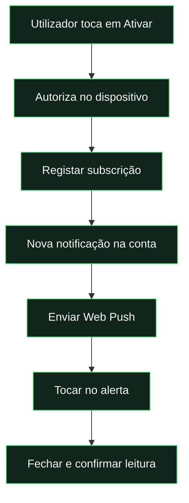

# Notificações do telemóvel

[← Documentação](../README.md) · [PWA](pwa.md) · [Publicação](deployment.md)

## Da ativação à leitura



## Duas apresentações, o mesmo registo

| Na aplicação                 | No telemóvel                                     |
| :--------------------------- | :----------------------------------------------- |
| Sino e lista **Por ler**.    | Alerta nativo, se o dispositivo estiver ativado. |
| Ler move para **Histórico**. | Tocar fecha o alerta e confirma a leitura.       |
| A leitura pertence à conta.  | Sem rede, a confirmação fica em fila local.      |

## O que é necessário

| Requisito         | Confirmar                                           |
| :---------------- | :-------------------------------------------------- |
| **Android**       | Browser compatível e notificações autorizadas.      |
| **iPhone / iPad** | Sistema 16.4+ e aplicação aberta pelo ecrã inicial. |
| **Servidor**      | Par VAPID correto, Functions e regras publicadas.   |
| **Teste**         | Enviar uma nova notificação depois da ativação.     |

> **Configuração pendente identificada em 15 de outubro de 2026:** o diagnóstico encontrou a chave privada VAPID cloud com formato inválido. A correção foi preparada localmente; a substituição do segredo e a republicação das duas Functions de dispositivos/entrega não foram executadas nesta revisão. Os testes locais não confirmam entrega num aparelho real.

<details>
<summary><strong>Não recebi o alerta: o que verificar?</strong></summary>

1. A notificação aparece no sino? Confirmar destinatário e conta.
2. O dispositivo concluiu **Ativar no telemóvel**? Verificar permissão no browser e no sistema.
3. Foi enviada **depois** de ativar? Mensagens antigas não são reenviadas automaticamente.
4. **Enviar teste** apresenta erro? Consultar configuração VAPID e logs das Functions.
5. O servidor confirmou envio? Verificar concentração, poupança de energia e definições de alertas do aparelho.

</details>

**Limite de sincronização:** outro dispositivo fechado reconcilia a leitura ao voltar a abrir. Não são enviados pushes silenciosos para remover o alerta à distância.

---

<details>
<summary><strong>Procedimentos completos e detalhes técnicos</strong></summary>

O projeto usa Web Push com subscrições nativas do browser, VAPID e mensagens encriptadas. As notificações continuam a ter origem nos documentos `users/{uid}/notifications`: não há uma segunda lista independente. As novas Functions enviam um alerta quando um desses documentos é criado e ainda está por ler.

## Experiência

- Na página **Notificações**, o utilizador escolhe **Ativar no telemóvel**. A permissão é pedida apenas ao tocar nesse botão. Não aparece um pedido automático ao entrar na aplicação.
- Na aplicação instalada, o Início também apresenta um convite compacto para ativar alertas; desaparece depois de concluir a ativação. Uma mensagem enviada pelo ADMIN não pede permissão nos dispositivos: aparece no sino de todos os destinatários e só gera push nos que já ativaram as notificações. Depois de ativar, enviar um novo teste; mensagens anteriores não são reenviadas como push automaticamente.
- O Chrome pode apresentar um pedido discreto ou permitir a alteração nas definições do site depois do pedido inicial. A interface acompanha alterações de permissão e conclui a subscrição após uma autorização tardia, apenas quando o utilizador já pediu a ativação nessa sessão/conta. Se a permissão estiver bloqueada, mostra instruções do browser/Android.
- No iPhone/iPad, é necessário iOS/iPadOS 16.4 ou superior e abrir a aplicação instalada pelo ecrã inicial. A versão no Safari orienta primeiro a instalação. No Android, um browser compatível pode receber push; a instalação oferece a experiência da aplicação.
- Depois de ativar, **Enviar teste** cria um alerta apenas para esse dispositivo. Há um intervalo mínimo de um minuto entre testes. **Desativar neste dispositivo** remove a subscrição local e o registo no servidor.
- O alerta usa o ícone da liga, um símbolo monocromático na barra Android e uma identificação estável para evitar cartões duplicados da mesma notificação.
- Tocar no alerta fecha-o imediatamente, abre a página relacionada e confirma a leitura no servidor. A ação **Marcar como lida**, quando o sistema a suporta, fecha e confirma sem abrir a aplicação.
- Sem rede, a confirmação fica em IndexedDB. O worker tenta novamente ao recuperar ligação, ao abrir a aplicação e através de Background Sync quando disponível. O ecrã offline também aciona a sincronização ao voltar a estar online.
- Ler na aplicação fecha também o alerta nativo desse dispositivo. A página apresenta **Por ler** e **Histórico**; as notificações lidas deixam a lista principal, preservando o histórico.
- A leitura é comum à conta. Outros dispositivos com a aplicação aberta recebem a alteração em tempo real e fecham os respetivos alertas. Num segundo dispositivo com a aplicação fechada, a reconciliação ocorre ao voltar a abrir: não se enviam pushes silenciosos, que não são permitidos no iOS. Desativar ou terminar sessão limpa alertas e badges locais.

Os sistemas operativos decidem a apresentação final, som, agrupamento e efeitos do modo de concentração. O badge é uma melhoria progressiva quando existe suporte. Os textos dos alertas podem aparecer no ecrã bloqueado segundo as preferências do utilizador.

## Servidor e proteção

- `pushDeviceAction`: registar, remover e testar o próprio dispositivo. Exige autenticação e uma conta ativa; valida origens, endpoints de fornecedores conhecidos e chaves de encriptação. Limite de dez dispositivos por conta.
- Antes de criar um teste, o servidor valida o formato da chave privada VAPID e a sua correspondência com a pública. Uma configuração inválida devolve um erro explícito e não cria um teste que pareça enviado. A função callable de dispositivos e o trigger de entrega recebem o segredo; devem ser republicados quando essa configuração for corrigida.
- `onNotificationPush`: entrega por dispositivo, controlo de concorrência, repetição de falhas transitórias e remoção de endpoints expirados. Um recibo identifica a revisão concreta da notificação; repetir o mesmo evento não repete uma entrega concluída.
- `ackPushNotification`: permite ao service worker confirmar leitura mesmo sem carregar o SDK ou renovar a sessão. Exige um recibo e uma capacidade aleatória de 256 bits enviados na mensagem encriptada. Só pode marcar aquela revisão de uma única notificação como lida; não permite consultar dados, escrever outras notificações nem agir sobre versões posteriores. Recibos expiram ao fim de 30 dias.
- `cleanupPushDeliveries`: limpeza diária de recibos expirados, em lotes limitados.

`pushDevices` e `pushDeliveries` são inacessíveis ao frontend, incluindo administradores. A chave VAPID pública está em `js/push-config.js`. A privada está em `.secret.local`, ignorada pelo Git e pelos pacotes públicos/de Functions, e deve ser guardada no Firebase Secret Manager como `WEB_PUSH_PRIVATE_KEY`. Não publicar nem partilhar a chave privada. Não regenerar o par após haver subscrições: uma rotação exige nova ativação nos dispositivos.

Se os registos mostrarem falha de configuração, verificar o par preservado com `npm run setup:push`. O valor do segredo cloud é apenas a chave privada, sem o nome `WEB_PUSH_PRIVATE_KEY=`, aspas ou o conteúdo de outros ficheiros. `setup:push:cloud` faz essa transferência corretamente sem imprimir o segredo. Uma chave pública colada nesse campo não substitui a privada. Os registos de entrega classificam a falha sem guardar o segredo nem o corpo da mensagem.

## Publicação

O par de chaves deste update já foi gerado localmente. Para preparar uma cópia nova do projeto, recuperar primeiro a chave privada correspondente; o script recusa pares incompletos ou inconsistentes.

```powershell
npm.cmd install
npx.cmd firebase login --reauth
npm.cmd run setup:push:cloud
npm.cmd run deploy
```

O passo `setup:push:cloud` guarda a chave privada no Secret Manager do projeto `pedalinhas-cards`; exige permissões nesse projeto. `deploy` publica frontend, Functions e regras em conjunto. **`deploy:frontend` sozinho não ativa push.** O projeto precisa de suportar Cloud Functions e respetivos serviços cloud (plano Blaze). No primeiro deploy, as Functions Gen 2 podem exigir a configuração normal de permissões Eventarc/Pub/Sub; consultar um erro de IAM real antes de alterar permissões.

Se o frontend continuar no GitHub Pages, publicar também a versão pública pelo fluxo habitual e executar `deploy:backend` no Firebase. Ambos usam o mesmo par VAPID. Outras origens/custom domains devem ser explicitamente incluídos em `allowedPushScope` antes de registar dispositivos.

## Validação

`npm.cmd run test:push` verifica o worker com IndexedDB real e a interface de ativação no browser. `test:backend` inclui entrega, capacidades de leitura, expiração, revisões, repetição, remoção de subscrições e transferência de conta. `test:rules` confirma que as coleções privadas não podem ser consultadas nem escritas pelo cliente.

Após publicação, confirmar num iPhone real e num Android real: instalar, iniciar sessão, ativar, enviar teste, fechar a aplicação, receber/tocar no alerta, verificar leitura e histórico, testar sem rede e voltar a ligar, desativar e terminar sessão. A automação local não confirma a entrega através dos servidores Apple/Google, IAM em produção ou a aparência dos alertas num aparelho físico.

O código local passa a enviar alertas em produção depois de configurar o par VAPID, publicar as Functions/regras/frontend e confirmar a ativação nos dispositivos. O estado da revisão está no [relatório da experiência](../reports/experience-review.md).

</details>
