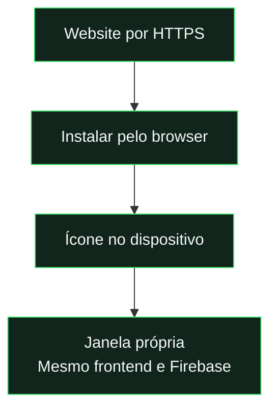

# PWA e instalação

[← Documentação](../README.md) · [Publicação](deployment.md) · [Push](notifications.md)

## O que é instalado

| Android                                     | iPhone                                         |
| :------------------------------------------ | :--------------------------------------------- |
| Pedido nativo quando disponível.            | Abrir no Safari.                               |
| Alternativa: instruções no menu do browser. | Partilhar → Adicionar ao ecrã principal.       |
| Abrir pelo ícone instalado.                 | Ativar “Abrir como aplicação”, quando aparece. |

**Não gera APK/IPA nem publica nas lojas.** A instalação utiliza a aplicação web.

## Rede e atualizações

| Situação            | Comportamento                                                 |
| :------------------ | :------------------------------------------------------------ |
| **Com Internet**    | Consultar a liga e guardar alterações.                        |
| **Sem Internet**    | Ecrã de recuperação; recursos públicos da interface em cache. |
| **Rede recuperada** | Verificar o servidor e recuperar o destino.                   |
| **Nova versão**     | Atualizar automaticamente num ecrã seguro; aguardar durante formulários. |

**O cache não guarda pedidos Firebase, dados privados nem gravações.** O worker publicado é o gerado por `build:hosting`.

[Ativação e leitura dos alertas →](notifications.md)

---

<strong>Procedimentos completos e detalhes técnicos</strong>

## Aplicação instalada

A PWA é a aplicação web instalada pelo browser: recebe um ícone no ecrã inicial, abre em modo standalone e continua a usar o mesmo frontend e Firebase. A distribuição atual não cria um APK/IPA nem publica nas lojas.

O início apresenta **“Instala já a APP”**, com símbolos iOS/Android e ajuda por plataforma. A instalação também está disponível na navegação. Quando a aplicação já está instalada/aberta em standalone, a interface evita repetir a promoção de instalação.

No layout desktop, o bloco fica no fim da página inicial. No layout mobile, aparece depois da saudação. A posição acompanha mudanças de largura sem duplicar o bloco nem alterar os botões de instalação.

No Android/Chromium, o botão usa o pedido nativo quando o browser disponibiliza `beforeinstallprompt`; caso contrário, mostra as instruções de instalação pelo menu. No iPhone, a ajuda orienta Safari → Partilhar → Adicionar ao ecrã principal, incluindo “Abrir como aplicação” quando aparece.

## Convite de notificações no início

Instalar a PWA e permitir notificações são passos diferentes. Em telemóvel, o início apresenta um popup a quem ainda não ativou os alertas num ambiente compatível. **Agora não** adia o convite sete dias, por conta e origem; a mesma sessão não o repete. O pedido nativo só começa após o toque no botão. No iPhone sem instalação, o botão orienta primeiro a instalação; se a permissão estiver bloqueada, mostra instruções.

Os alertas usam o service worker com ou sem uma janela aberta. O sistema operativo controla a apresentação final. Consultar [push](notifications.md) para configuração, limites e testes de entrega.

## Identidade

`manifest.webmanifest` define nome, idioma, âmbito relativo, arranque, cores, modo standalone e atalhos para jogos, missões e perfil. Os ícones PNG, maskable e Apple touch derivam do emblema da liga e ficam em `assets/pwa/`.

O frontend considera safe areas, alturas dinâmicas e o modo standalone. Os quatro temas mantêm a identidade da interface; a escolha também atualiza a cor do browser.

## Cache e rede

`build:hosting` calcula uma versão a partir dos recursos públicos e injeta o inventário em `sw.js`. O worker guarda a versão completa e separa caches por âmbito, preservando os de outras aplicações no mesmo domínio.

HTML e módulos mantêm a mesma versão até ativar uma atualização. O cache inclui recursos públicos; não guarda pedidos Firebase, APIs, fotografias privadas ou gravações. A consulta dos dados da liga e as alterações precisam de internet.

Sem ligação, a abertura apresenta `offline.html`. A recuperação verifica o servidor, conserva o destino e volta à aplicação quando a rede está disponível. A fila de confirmações de leitura de push é independente e pode persistir offline; ver [notificações](notifications.md).

## Atualizações

Um novo worker aguarda que todas as janelas da app respondam que estão visíveis e sem formulários, diálogos ou edição de conteúdo. Depois ativa a versão e recarrega automaticamente, tanto no navegador como na app instalada. A verificação repete-se a cada 15 segundos, ao navegar e ao regressar à app; o regresso também procura uma nova versão. Enquanto houver um formulário aberto, mesmo com gravação automática, a atualização espera que o utilizador saia desse ecrã. Abas em segundo plano ou com versões antigas também adiam a ativação; fechar essas abas permite continuar. O trabalho por guardar nunca é descartado para atualizar.

Na transição para este mecanismo, uma instalação que ainda tenha o código antigo pode pedir uma última atualização manual. As versões seguintes usam a atualização automática. Publicar não garante instalação imediata: é necessária ligação e uma nova consulta do service worker.

O worker deve ser publicado a partir do build em `.firebase/site`, com inventário/hash corretos. O ficheiro fonte é destinado ao desenvolvimento e tem um inventário mínimo.

Se uma app instalada apresentar «não tens permissões» ao avaliar, confirmar primeiro que ativou a atualização disponível, preservando escolhas ainda não guardadas. Uma versão antiga pode tentar escrever diretamente no Firestore, enquanto a versão atual usa `feedbackAction` para gravar avaliação e revisão juntas. Não assumir que esse erro exige perfil de administrador ou abrir as regras de escrita. Se continuar atualizado, recolher jogador, jogo, hora e código do erro e verificar conta, participação, janela de edição e logs do callback. [Exemplo de auditoria datada](../reports/feedback-mobile-access-2026-10-19.md).

## Confirmar nos aparelhos

`npm.cmd run test:pwa` verifica o worker real em raiz e subpasta, manifest, ícones, cache privado excluído, recuperação offline e atualização automática adiada enquanto existe um formulário. Os testes não substituem a instalação física.

Depois de publicar por HTTPS, testar em iPhone e Android: instalação, arranque pelo ícone, conta, navegação, safe areas, teclado, fotografias, reabertura offline, regresso da rede e atualização de uma versão já instalada.

A instalação Web Push no iPhone exige a aplicação no ecrã inicial e uma versão do sistema compatível. Os passos e limites estão no [guia de push](notifications.md).

## Atualizações visuais dos percursos

O build de Hosting inclui os módulos dos percursos e `css/paths.css` no inventário da PWA. Depois de publicar alterações, confirmar que a aplicação carregou a nova versão e abrir Missões com e sem preparação. Verificar o objetivo **No próximo jogo**, o destino do nó e a legibilidade da composição compacta nos temas usados. As [capturas locais](../reports/path-interface-2026-10-19.md) usam fixtures de browser; a confirmação numa instalação física e da versão publicada é uma etapa distinta.
