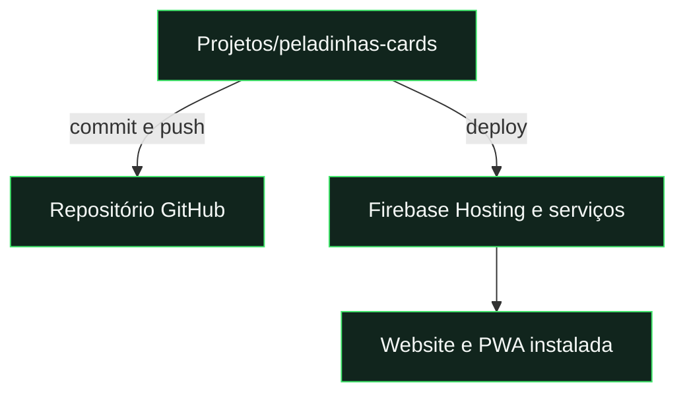

# Repositório e migração

[← Documentação](../README.md) · [Desenvolvimento](development.md) · [Publicação](deployment.md)

## Localização atual

| Elemento                | Destino                                                                                   |
| :---------------------- | :---------------------------------------------------------------------------------------- |
| **Código no GitHub**    | [MeguminKami/peladinhas-cards](https://github.com/MeguminKami/peladinhas-cards) · público |
| **Pasta de trabalho**   | `C:\Users\Joao\Desktop\Projetos\peladinhas-cards`                                         |
| **Aplicação publicada** | [pedalinhas-cards.web.app](https://pedalinhas-cards.web.app/)                             |
| **Projeto Firebase**    | `pedalinhas-cards`                                                                        |



**GitHub guarda o código. Firebase aloja a aplicação e os dados.** Um push não equivale a um deploy.

## Trabalhar noutro computador

```powershell
git clone https://github.com/MeguminKami/peladinhas-cards.git
cd peladinhas-cards
npm.cmd ci
npm.cmd run dev
```

Recuperar a chave privada VAPID por transferência segura apenas quando necessária. Não faz parte do clone.

## Criar uma cópia limpa

```powershell
npm.cmd run export:repo
```

| Inclui                                   | Exclui                                            |
| :--------------------------------------- | :------------------------------------------------ |
| Código, configurações públicas e regras. | Chaves privadas e ficheiros `.env*` / `.secret*`. |
| Testes, scripts, documentação e design.  | Dependências, caches, builds e logs.              |
| `package-lock.json`.                     | Histórico `.git`.                                 |

**Destino:** `.repository-export/peladinhas-cards/` · **Inventário:** `.repository-export/inventory.json`

O script verifica os links da documentação e a ausência do valor da chave privada local. A exportação é uma fotografia dos ficheiros atuais, não um substituto de commit e push.

## Se mudar apenas o repositório

**Mantém-se:** URL do site · Firebase · contas · dados · instalações PWA · subscrições push.

Não é necessário ativar GitHub Pages nem criar outro projeto Firebase.

<details>
<summary><strong>Se mudar o domínio ou o projeto Firebase</strong></summary>

| Rever                          | Ação                                                                       |
| :----------------------------- | :------------------------------------------------------------------------- |
| README                         | Atualizar as ligações da aplicação.                                        |
| `js/config.js` e `.firebaserc` | Confirmar o projeto de destino.                                            |
| Authentication                 | Autorizar o domínio; conservar `auth.weeklyfc.app` para contas existentes. |
| Hosting / PWA                  | Publicar `.firebase/site`, gerado por `build:hosting`.                     |
| Push                           | Rever `allowedPushScope` em `functions/push.js`.                           |
| Outro projeto Firebase         | Rever também o endpoint permitido em `js/push-worker.js`.                  |
| VAPID                          | Preservar o par público/privado e transferir a privada fora do Git.        |

Uma nova origem não transporta sessões, localStorage, IndexedDB, instalações PWA ou subscrições push. Os utilizadores precisam de abrir a nova origem, voltar a instalar e ativar notificações.

</details>

<details>
<summary><strong>Como funciona a exportação</strong></summary>

O script usa uma lista explícita de entradas e recusa links simbólicos. Exclui `.git`, `node_modules`, `.firebase`, `test-results`, logs e segredos. Recria apenas `.repository-export/peladinhas-cards/`; não remove a pasta de trabalho.

Se criares um novo repositório a partir da exportação, preserva os ficheiros ocultos `.gitignore` e `.firebaserc`. Instala as dependências e valida antes do primeiro commit. Não copies o histórico do portefólio.

</details>
