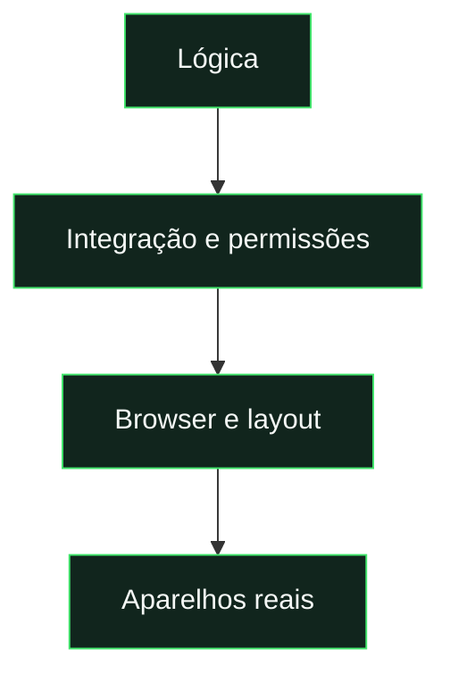

# Testes e validação

[← Documentação](../README.md) · [Desenvolvimento](development.md) · [Publicação](deployment.md)

## Escolher pelo tipo de alteração

| Alterei…                                 | Verificar                                         |
| :--------------------------------------- | :------------------------------------------------ |
| Qualquer módulo                          | `check`                                           |
| Cálculos ou regras do produto            | `test`                                            |
| Textos, imagens ou links da documentação | `test:docs`                                       |
| Interface e fluxos                       | `test:ui` + `test:review`                         |
| Permissões                               | `test:rules`                                      |
| Functions                                | `test:backend`                                    |
| Instalação, cache ou atualização         | `test:pwa`                                        |
| Notificações                             | `test:push` + backend/regras conforme a alteração |
| Pacote público                           | `test:hosting`                                    |

Executar os scripts com `npm.cmd run NOME`; para os testes de lógica, usar `npm.cmd test`.



## Cobertura visual

**Desktop:** 1440 · 1024 px &nbsp; / &nbsp; **Tablet:** 768 px

**Mobile:** 430 · 390 · 360 · 320 px &nbsp; / &nbsp; **Horizontal:** três dimensões

| Automação local                          | Confirmar em produção / aparelho                       |
| :--------------------------------------- | :----------------------------------------------------- |
| Fixtures, emuladores, Chromium e WebKit. | Instalação física, teclado e apresentação dos alertas. |
| Cache, offline e leitura sincronizada.   | Entrega Apple/Google e permissões cloud.               |

**WebKit no computador ajuda a detetar problemas de Safari; não substitui um iPhone.**

---

<details>
<summary><strong>Procedimentos completos e detalhes técnicos</strong></summary>

## Escolher a verificação

| Comando                | O que verifica                                                                      |
| :--------------------- | :---------------------------------------------------------------------------------- |
| `npm run check`        | Sintaxe dos módulos da aplicação, Functions e scripts.                              |
| `npm test`             | Cartas, avaliações, progressão, eventos, semanas, equipas, horas de Lisboa e URLs.  |
| `npm run test:docs`    | Ligações locais, imagens, âncoras e organização da documentação.                    |
| `npm run test:rules`   | Acesso e escrita Firestore por papel, com emulador.                                 |
| `npm run test:backend` | Callables, triggers, recompensas, snapshots e push em Firestore emulado.            |
| `npm run test:ui`      | Fluxos da aplicação, formulários, jogos, cartas e estados, com fixtures.            |
| `npm run test:review`  | 27 rotas em dez dimensões, overflow, navegação, modais e capturas.                  |
| `npm run test:push`    | Worker, IndexedDB, leitura offline e interface de ativação, com serviços simulados. |
| `npm run test:pwa`     | Frontend preparado, manifest, ícones, cache, offline, âmbito e atualizações.        |
| `npm run test:hosting` | Ficheiros publicados e exclusão de recursos internos no emulador Hosting.           |

Os testes de browser não usam contas nem dados de produção. As fixtures substituem autenticação e acesso à base de dados. Os testes backend de push injetam um transportador simulado e não enviam mensagens reais.

## Browser

Os scripts Playwright usam Microsoft Edge no Windows e Chromium nos restantes sistemas. Instalar Chromium quando necessário:

```powershell
npx.cmd playwright install chromium
npm.cmd run test:ui
npm.cmd run test:review
```

Para validar diferenças de Safari:

```powershell
npx.cmd playwright install webkit
node tests/review.mjs --webkit
node tests/push-worker.mjs --webkit
```

Se `PLAYWRIGHT_BROWSERS_PATH` estiver definido, instalar e executar com o mesmo valor. Não é necessário preservar os motores de browser na mudança de repositório: podem ser reinstalados.

O review cobre 1440×900, 1024×900, 768×900, 430×900, 390×844, 360×800, 320×568 e três vistas horizontais: 932×430, 844×390 e 780×360. Capturas e resultados ficam em `test-results/review/` e `test-results/review-webkit/`.

## Emuladores

`test:rules` usa o Firestore de `firebase.json`; `test:backend` usa a configuração dedicada `firebase.backend.json`. As portas e o projeto `demo-*` aparecem no comando de cada script. Se uma porta estiver ocupada, confirmar qual o processo antes de alterar a configuração; não encerrar um emulador de outro trabalho.

Para um teste específico, pode usar-se um emulador já iniciado, desde que se confirme o endereço e se defina `FIRESTORE_EMULATOR_HOST`. Usar sempre um projeto de demonstração. Os testes de regras apagam os dados do projeto emulado que usam.

## Limites da automação

Playwright/WebKit no computador não substitui um iPhone físico. A entrega Apple/Google, permissões IAM e faturação do Firebase também não são confirmadas pelos mocks. A validação depois do deploy inclui instalar, abrir pelo ícone, iniciar sessão, usar formulários/teclado, receber um alerta com a app fechada, tocar nele, voltar a abrir sem rede e verificar uma atualização da PWA.

Os guias [PWA](pwa.md) e [push](notifications.md) detalham os cenários de cada plataforma.

</details>
