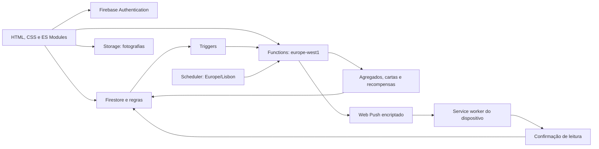

# Arquitetura e estrutura

[← Documentação](../README.md) · [Desenvolvimento](../guides/development.md)

## Organização

```text
peladinhas-cards/
├── README.md                  Apresentação visual e entradas para a documentação
├── index.html                 Entrada da aplicação
├── offline.html               Recuperação sem ligação
├── manifest.webmanifest       Identidade e instalação PWA
├── sw.js                      Cache, atualização e ligação ao worker push
├── assets/                    Recursos públicos prontos a entregar
├── css/                       Interface, cartas, temas e adaptação a ecrãs
├── js/                        Páginas, componentes, dados e regras partilhadas
├── functions/                 Callables, triggers e tarefas agendadas
├── scripts/                   Desenvolvimento, validação, imagens e publicação
├── tests/                     Lógica, regras, backend, browser e fixtures
├── design/sources/            Originais de fontes e playstyles
├── docs/
│   ├── README.md              Índice da documentação
│   ├── guides/                Procedimentos de trabalho e publicação
│   ├── reference/             Regras do produto e arquitetura
│   ├── reports/               Registo de revisão e validação
│   └── media/                 Hero e imagens da apresentação
├── package.json               Comandos e dependências
├── package-lock.json          Versões reproduzíveis
├── firebase.json              Serviços, emuladores e Hosting
├── firebase.backend.json      Emulador usado pelos testes de servidor
├── firestore.rules            Permissões dos documentos
├── firestore.indexes.json     Índices Firestore
└── storage.rules              Permissões das fotografias
```

Na raiz ficam as entradas web e configurações usadas diretamente pelo browser/Firebase. Os módulos mantêm os caminhos existentes para não introduzir uma mudança de aplicação disfarçada de organização do repositório. Os ficheiros gerados e segredos são locais e ignorados pelo Git.

## Fluxo de dados



O browser lê os dados permitidos pelas regras e chama operações protegidas no servidor. As Functions produzem agregados, recompensas e snapshots; as regras impedem a escrita direta do cliente nessas coleções. Fotografias usam Storage com validação e limites próprios.

O frontend Firebase usa SDK web por importação remota; o servidor usa as dependências npm. A configuração web é pública e não concede permissões de administrador. As permissões dependem de Authentication, regras e verificações das Functions.

## Módulos

| Área                      | Entradas principais                                                                       |
| :------------------------ | :---------------------------------------------------------------------------------------- |
| Navegação e sessão        | `js/app.js`, `navigation.js`, `auth.js`, `role-perspective.js`                            |
| Dados e liga              | `js/db.js`, `data.js`, `utils.js`, `match-time.js`                                        |
| Cartas e criação          | `js/cards.js`, `card-design.js`, `card-photo.js`, `card-lab.js`, `card-studio-catalog.js` |
| Jogos e avaliações        | `js/games.js`, `ratings.js`, `team-balance.js`, `missions.js`                             |
| Eventos e objetivos       | `js/events.js`, `event-pages.js`, `event-admin.js`, `event-model.js`, `event-rules.js`    |
| Administração             | `js/admin.js`, `admin-cards.js`, `admin-menu.js`, `ovr-audit.js`                          |
| Componentes comuns        | `js/ui.js`, `icons.js`, `themes.js`, `assets.js`                                          |
| Instalação e notificações | `js/pwa.js`, `push.js`, `push-worker.js`, `notifications.js`, `offline.js`                |
| Servidor                  | `functions/index.js`, `events.js`, `event-management.js`, `notifications.js`, `push.js`   |

`css/styles.css` define a base, `cards.css` a linguagem das cartas e `responsive.css` os layouts específicos. `experience.css` reúne os refinamentos comuns, fontes e componentes da revisão. Usar as variáveis de tema existentes ao alterar cores.

## Coleções

| Dados               | Coleções principais                                          |
| :------------------ | :----------------------------------------------------------- |
| Perfis e avaliações | `users`, `initialRatings`, `communityRatings`                |
| Jogos e feedback    | `games`, `games/{id}/feedback`, `gameBalances`               |
| Agregados           | `communitySummaries`, `gameSummaries`                        |
| Cartas e histórico  | `weeklyCards`, `weeklyCardPhotos`, `users/{uid}/cardHistory` |
| Eventos             | `events`, `events/{id}/votes`, `eventRewards`                |
| Configuração        | `settings/ovr`, `ovrPresets`, `cardThemes`                   |
| Apoio               | `tickets`, `tickets/{id}/messages`                           |
| Notificações        | `users/{uid}/notifications`                                  |
| Push privado        | `pushDevices`, `pushDeliveries` · apenas Functions           |

## Papéis

| Papel         | Capacidades                                                                   |
| :------------ | :---------------------------------------------------------------------------- |
| Membro        | Perfil próprio, avaliações elegíveis, feedback dos seus jogos, votos e apoio. |
| DBS           | Capacidades de membro e gestão dos jogos permitidos, equipas e encerramento.  |
| Administrador | Jogadores, papéis, OVR, cartas, eventos, avaliações, tickets e manutenção.    |

A perspetiva visual de um papel não muda a identidade autenticada nem substitui permissões no servidor. Votos e feedback individual são limitados ao autor e à administração; os restantes membros consultam os agregados permitidos. Regras e Functions são a autoridade para cada operação.

## Pacotes de publicação

`build:hosting` copia apenas entradas web, `js/`, `css/` e `assets/` para `.firebase/site`, e injeta no worker um inventário e hash. Não publica documentação, fontes de trabalho, testes, ferramentas nem segredos.

O pacote de Functions usa a raiz como fonte porque partilha regras de cálculo com `js/`. `firebase.json` exclui os recursos visuais, documentação, originais, caches, dependências locais e segredos; as dependências npm são instaladas no ambiente de Functions.
