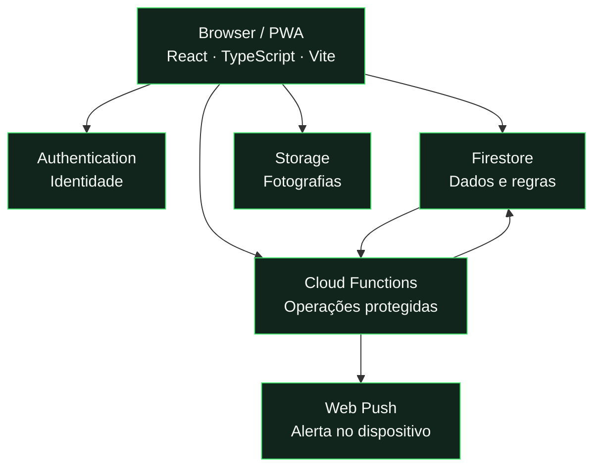
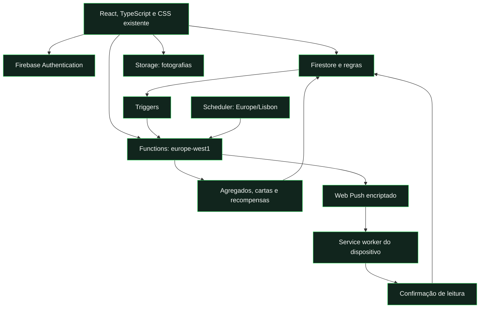

# Arquitetura e estrutura

[← Documentação](../README.md) · [Desenvolvimento](../guides/development.md)

## Mapa do sistema



## Onde alterar

| Quero alterar…          | Pasta / entrada                     |
| :---------------------- | :---------------------------------- |
| Páginas e interações    | `src/app/`, `src/presentation/`, `src/features/` |
| Layout, temas e cartas  | `css/`                              |
| Operações protegidas    | `functions/`                        |
| Permissões de dados     | `firestore.rules` · `storage.rules` |
| Recursos públicos       | `assets/`                           |
| Fontes de trabalho      | `design/sources/`                   |
| Validação automática    | `tests/`                            |
| Ferramentas de trabalho | `scripts/`                          |

## Fronteiras de acesso

**Membro → ações elegíveis** · **DBS → jogos permitidos** · **ADMIN → gestão da liga**

A interface mostra as ações disponíveis. **As regras e as Functions autorizam cada operação.** Uma mudança de perspetiva visual não concede permissões.

---

<details>
<summary><strong>Regras completas e implementação</strong></summary>

## Organização

```text
peladinhas-cards/
├── README.md                  Apresentação visual e entradas para a documentação
├── frontend/index.html        Entrada Vite da aplicação React
├── src/                       Componentes, estado e adaptadores tipados
├── index.html                 Entrada anterior conservada como referência
├── offline.html               Recuperação sem ligação
├── manifest.webmanifest       Identidade e instalação PWA
├── sw.js                      Cache, atualização e ligação ao worker push
├── assets/                    Recursos públicos prontos a entregar
├── css/                       Interface, cartas, temas e adaptação a ecrãs
├── js/                        Serviços Firebase, domínio e editor Card Lab existente
├── functions/                 Callables, triggers e tarefas agendadas
├── scripts/                   Desenvolvimento, validação, imagens e publicação
├── tests/                     Lógica, regras, backend, browser e fixtures
├── design/sources/            Originais de fontes e playstyles
├── docs/
│   ├── README.md              Índice da documentação
│   ├── guides/                Procedimentos de trabalho e publicação
│   ├── reference/             Regras do produto e arquitetura
│   ├── reports/               Registo de revisão e validação
│   └── media/                 Hero e imagens da apresentação
├── package.json               Comandos e dependências
├── package-lock.json          Versões reproduzíveis
├── firebase.json              Serviços, emuladores e Hosting
├── firebase.backend.json      Emulador usado pelos testes de servidor
├── firestore.rules            Permissões dos documentos
├── firestore.indexes.json     Índices Firestore
└── storage.rules              Permissões das fotografias
```

Na raiz ficam as entradas web e configurações usadas diretamente pelo browser/Firebase. Os módulos mantêm os caminhos existentes para não introduzir uma mudança de aplicação disfarçada de organização do repositório. Os ficheiros gerados e segredos são locais e ignorados pelo Git.

## Fluxo de dados



O browser lê os dados permitidos pelas regras e chama operações protegidas no servidor. As Functions produzem agregados, recompensas e snapshots; as regras impedem a escrita direta do cliente nessas coleções. Fotografias usam Storage com validação e limites próprios.

O frontend usa o SDK modular Firebase instalado por npm e integrado pelo Vite. Os caminhos antigos do SDK nos serviços partilhados são resolvidos para essa dependência pelo build. A configuração web é pública e não concede permissões de administrador. As permissões dependem de Authentication, regras e verificações das Functions.

## Módulos

| Área                      | Entradas principais                                                                       |
| :------------------------ | :---------------------------------------------------------------------------------------- |
| Navegação e sessão        | `src/app/Application.tsx`, `Chrome.tsx`, `src/services/league.ts`, `js/auth.js` |
| Dados e liga              | `js/db.js`, `data.js`, `utils.js`, `match-time.js`                                        |
| Cartas e criação          | `src/presentation/cards.tsx`, `profile.tsx`, `src/features/CardLab.tsx`; motor `js/card-lab.js` |
| Jogos e avaliações        | `src/features/game-page.tsx`, `feedback.tsx`, `initial-rating.tsx`, `team-builder.tsx`, `use-rating-draft.ts` |
| Eventos e objetivos       | `src/features/event-admin.tsx`, `managed-event.tsx`, `legacy-event.tsx`; domínio `js/event-model.js`, `event-rules.js` |
| Administração             | `src/features/admin.tsx`, `admin-cards.tsx`, `weekly-photo.tsx`, `ovr-audit.tsx` |
| Componentes comuns        | `src/shared/`, ícones/temas/assets existentes em `js/` |
| Instalação e notificações | `src/app/Pwa.tsx`, `PushSettings.tsx`, `src/features/notifications.tsx`; serviços `js/push.js`, `push-worker.js`, `offline.js` |
| Servidor                  | `functions/index.js`, `events.js`, `event-management.js`, `notifications.js`, `push.js`   |

`css/styles.css` define a base, `cards.css` a linguagem das cartas e `responsive.css` os layouts específicos. `experience.css` reúne os refinamentos comuns, fontes e componentes da revisão. Usar as variáveis de tema existentes ao alterar cores.

## Coleções

| Dados               | Coleções principais                                          |
| :------------------ | :----------------------------------------------------------- |
| Perfis e avaliações | `users`, `initialRatings`, `communityRatings`                |
| Jogos e feedback    | `games`, `games/{id}/feedback`, `gameBalances`               |
| Agregados           | `communitySummaries`, `gameSummaries`                        |
| Cartas e histórico  | `weeklyCards`, `weeklyCardPhotos`, `users/{uid}/cardHistory` |
| Eventos             | `events`, `events/{id}/votes`, `eventRewards`                |
| Configuração        | `settings/ovr`, `ovrPresets`, `cardThemes`                   |
| Apoio               | `tickets`, `tickets/{id}/messages`                           |
| Notificações        | `users/{uid}/notifications`                                  |
| Push privado        | `pushDevices`, `pushDeliveries` · apenas Functions           |

## Papéis

| Papel         | Capacidades                                                                   |
| :------------ | :---------------------------------------------------------------------------- |
| Membro        | Perfil próprio, avaliações elegíveis, feedback dos seus jogos, votos e apoio. |
| DBS           | Capacidades de membro e gestão dos jogos permitidos, equipas e encerramento.  |
| Administrador | Jogadores, papéis, OVR, cartas, eventos, avaliações, tickets e manutenção.    |

O administrador pode corrigir dados, equipas, resultado, golos e assistências de jogos encerrados. O jogo mantém o estado encerrado, a data e o autor do fecho; as estatísticas são recalculadas pelo processamento do jogo. DBS só edita jogos ainda não encerrados.

A perspetiva visual de um papel não muda a identidade autenticada nem substitui permissões no servidor. Votos e feedback individual são limitados ao autor e à administração; os restantes membros consultam os agregados permitidos. Regras e Functions são a autoridade para cada operação.

## Pacotes de publicação

`build:hosting` verifica TypeScript, executa Vite e prepara `.firebase/site` com bundles, CSS e assets existentes, página offline e worker push. Injeta no service worker o inventário completo e o hash do conteúdo. Não publica documentação, fontes de trabalho, testes, ferramentas, código de servidor nem segredos.

O pacote de Functions usa a raiz como fonte porque partilha regras de cálculo com `js/`. `firebase.json` exclui os recursos visuais, documentação, originais, caches, dependências locais e segredos; as dependências npm são instaladas no ambiente de Functions.

</details>
