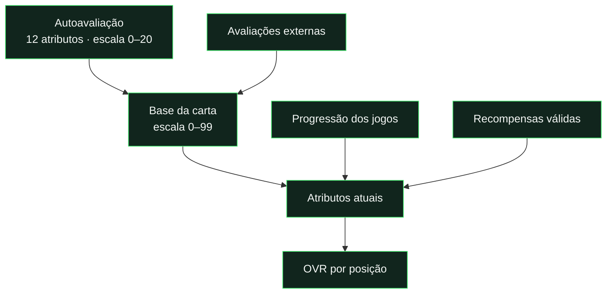

# Cartas, avaliações e OVR

Os valores descritos abaixo são os valores iniciais. As regras configuráveis e a preservação do histórico estão descritas em [Manutenção](maintenance.md).

[← Documentação](../README.md) · [Progressão por jogo](progression.md) · [Eventos](events-and-missions.md)

## A carta em três passos

| Momento                            | O que acontece                                  |
| :--------------------------------- | :---------------------------------------------- |
| **Autoavaliação concluída**        | É criada a primeira carta.                      |
| **Primeiro voto externo completo** | A autoavaliação passa a ter peso máximo de 20%. |
| **Três votos externos completos**  | A carta passa a oficial.                        |
| **Jogos avaliados**                | Alimentam a progressão dos atributos.           |
| **Fecho semanal**                  | Guarda a carta dessa semana no histórico.       |

## Distinguir os indicadores

| Indicador         | Significado                                                      |
| :---------------- | :--------------------------------------------------------------- |
| **Atributos**     | Capacidades individuais do jogador.                              |
| **OVR**           | Média ponderada dos 12 atributos pela posição principal.         |
| **Forma recente** | Últimas cinco avaliações agregadas de jogo disponíveis.          |
| **Forma semanal** | Desempenho no ciclo; exige pelo menos duas avaliações recebidas. |
| **—**             | Não há dados suficientes; não significa zero.                    |

## Guarda-redes no feedback de jogo

As avaliações de jogo são guardadas imediatamente e os resultados derivados são publicados nos quatro ciclos diários e no fecho de jogo, apenas para jogos alterados. Consultar [processamento das avaliações](feedback-processing.md) para distinguir submissão, publicação, apuramento do ETC e recálculo administrativo.

Quando a autoavaliação **submetida** tem guarda-redes N/A, esse critério fica excluído para o jogador nesse jogo, mesmo que colegas tenham enviado números antes. A média é `null` e a contagem válida dessa dimensão é zero. O formulário dos colegas mostra N/A bloqueado e uma explicação; as restantes dimensões continuam editáveis dentro do respetivo prazo. As regras impedem novas notas numéricas incompatíveis; a correção administrativa de uma resposta de colega conserva N/A.

Um rascunho não determina esta exclusão. Uma nota de zero é uma avaliação válida e distingue-se de N/A. A autoavaliação inicial de 12 atributos não é alterada por esta regra. Depois de publicar uma mudança do cálculo, **Recalcular liga** atualiza agregados existentes e cartas em evolução; não reescreve semanas fechadas.

## Ciclo semanal · hora de Lisboa

**Uma carta fechada conserva o estado da semana.** A posição muda os pesos do OVR, não os atributos.

[Ver a fórmula de progressão →](progression.md)

Desde 26/10/2026, novos jogos usam progressão gradual, bónus próprios de golos/assistências e ganhos reduzidos em derrotas. Jogos anteriores mantêm a sua fórmula. Em **Jogadores → (i) Como as tuas estatísticas mudam**, consultar a explicação e o simulador sem alterar a carta.

---

<strong>Regras completas e implementação</strong>

## Da primeira carta à carta oficial

As avaliações externas completas com média **igual ou inferior a 1,9 na escala 0–20** são nulas e não entram na base, contagem de avaliações válidas nem na data de elegibilidade comunitária. O servidor valida no momento da submissão e atualiza o resumo comunitário antes de responder; as cartas continuam a ser publicadas nos ciclos previstos. O autor recebe um aviso privado sem o motivo numérico e fica impedido de editar. No ADMIN, o estado é **Nula**, incluindo votos antigos identificados na consulta, com o botão **Dar mais uma tentativa**. Só um admin com capacidade de avaliações pode autorizar a única revisão definitiva, com registo de auditoria. A janela configurada de edição (sete dias por omissão) começa nessa autorização. Rascunhos não consomem a revisão. A segunda submissão fica bloqueada: conta se for válida, ou permanece nula sem possibilidade de terceira tentativa. Revisões automáticas antigas sem autorização administrativa também ficam bloqueadas. A autoavaliação inicial e o feedback de jogos não usam este filtro. [Implementação atual e publicação](../reports/community-rating-null-2026-10-27.md).

A autoavaliação completa dos 12 atributos usa a escala 0–20 e permite criar a primeira carta. Desde o primeiro voto externo completo, o peso da autoavaliação é min(20%, 1 / (N + 1)), com N avaliações externas; com 1 a 4 avaliações externas. A partir de 5 avaliações externas, a referência é 4% para a autoavaliação e 96% para a comunidade. Os 96% são divididos pelas avaliações externas, truncando cada percentagem a duas casas decimais; o resto é somado à autoavaliação. Com 13 externas, cada uma pesa 7,38% e a autoavaliação 4,06%. Sem votos externos, a primeira carta provisória usa a autoavaliação. Com três avaliações externas completas, a carta passa a oficial.

Os valores são convertidos para a escala 0–99 da carta. Avaliações da comunidade, feedback de jogos e recompensas têm responsabilidades distintas: a comunidade estabelece a base; os jogos alimentam a progressão; os eventos aplicam recompensas validadas pelo servidor.

## Atributos e OVR

A carta acompanha velocidade, finalização, passe, drible, defesa, físico, guarda-redes, resistência, visão de jogo, posicionamento, jogo de equipa e compostura. O OVR é a média ponderada dos 12 atributos segundo a posição principal: GR, DEF, ALA, MED ou AV.

Cada conjunto de pesos soma 100%. A administração pode editar pesos e presets; o painel de auditoria apresenta os valores, pesos, contributos e arredondamento. A posição altera os pesos do OVR, não os atributos do jogador.

As ausências não reduzem atributos nem OVR. A contagem de jogos consecutivos sem participação é apenas informativa. Cartas de semanas fechadas conservam os valores e eventuais penalizações históricas guardadas.

## Jogos, forma e estatísticas

O feedback de jogo usa a escala de estrelas. Guarda-redes N/A é excluído da média dessa dimensão. Dimensões não avaliadas não inventam uma avaliação. A evolução guarda decimais entre jogos e apresenta atributos arredondados na carta.

A fórmula considera avaliações absolutas e relativas às duas equipas, resultado, margem, golos e assistências, com ganhos/perdas limitados, boost de OVR baixo e desaceleração dos atributos elevados. Ver [a fórmula e simulação reproduzível](progression.md).

No início, “A minha carta” apresenta OVR, forma recente, jogos, vitórias, golos e assistências. A forma resume as últimas cinco avaliações agregadas de jogo disponíveis; “—” indica ausência de dados, não uma classificação de zero. Os totais de jogos e contribuições vêm de jogos finalizados.

O ranking semanal e o pódio Performance consideram os jogos desde o último fecho semanal até ao seguinte, incluindo jogos anteriores à abertura das cartas. Exigem pelo menos duas avaliações reais por jogo para a forma semanal. O OVR serve de desempate e de referência quando faltam avaliações semanais. A página de estatísticas permite comparar a liga e ordenar os jogadores.

## Ciclo semanal

Desde 21/10/2026, o ciclo abre à quinta-feira às 12:00 e fecha à quarta-feira às 18:00, em Lisboa. A pausa dura até à quinta-feira seguinte às 12:00. A conversão respeita inverno/verão e não depende do fuso do dispositivo. Os ciclos anteriores mantêm o fecho histórico às 12:00. Uma carta da semana corrente bloqueada pelo horário anterior é reaberta durante a extensão, ao atualizar o histórico, e volta a fechar às 18:00; semanas passadas não são reescritas. Configurações explícitas posteriores podem definir outro calendário. [Transição e validação](../reports/weekly-close-18-2026-10-21.md).

As cartas na página principal e na lista de jogadores mostram apenas setas verdes ou vermelhas para a evolução de OVR e atributos face à semana anterior. Só no perfil são mostradas as diferenças numéricas: OVR, os 12 atributos e um resumo de quantos subiram ou desceram. Sem carta da semana anterior, não se inventa uma variação.

Esta comparação usa apenas os atributos e o OVR **permanentes** das duas semanas: as recompensas permanentes contam; a entrada, renovação ou expiração de bónus temporários não conta. Os números apresentados na carta continuam a incluir os bónus ativos. O cálculo parte dos atributos anteriores aos bónus, respeitando o limite de 99, os pesos e a penalização por inatividade de cada semana. Quando uma carta antiga com bónus não tem dados suficientes para reconstruir os valores permanentes, a diferença fica indisponível em vez de estimada.

Quando o jogador tem uma especial disponível, o próprio perfil mostra «Escolher carta», incluindo sempre a carta normal. A escolha pertence ao jogador e persiste entre semanas, podendo ser alterada também durante a pausa. Ao expirar uma carta, a aplicação regressa à normal. O histórico fechado mantém a escolha original; alterar a aparência atual nunca reescreve um snapshot fechado.

Uma carta fechada preserva atributos, OVR, especiais, posição e aparência. O histórico semanal permite ampliar essas cartas e consultar a evolução. Alterações posteriores não devem reescrever a memória visual de uma semana fechada.

## Identidade e recompensas

A carta **Em forma (In Form)** tem três versões visuais: bronze, prata e ouro. Ao receber esta recompensa, o jogador usa automaticamente o metal da sua carta base (bronze abaixo de 65 OVR, prata de 65 a 74, ouro a partir de 75), incluindo variantes comuns e raras. A recompensa mantém o ID `in-form`; o histórico usa a raridade base guardada na respetiva semana. As três versões podem ser pré-visualizadas no catálogo e no Card Lab.

A [coleção especial](card-collection.md) acrescenta dezanove edições visuais ao catálogo e ao Card Lab, incluindo nove temas inspirados no Ultimate Team. Quinze têm [condições de conquista e validade](card-unlocks.md); quatro designs ficam em reserva.

Há sete tipos base e cartas especiais reconhecidas por performances/recompensas. O Card Lab permite ao ADMIN compor estilos com todos os modelos do catálogo, paletas, camadas, molduras, fontes, efeitos e fotografia. A biblioteca permite reabrir e editar uma composição guardada, guardar alterações mantendo o seu ID ou criar uma cópia. Inclui desfazer/refazer e importação/exportação JSON; importar um projeto inicia uma nova composição. O catálogo dá acesso direto à edição dos modelos guardados e à criação a partir dos modelos padrão.

A bancada mantém a carta visível e limita o scroll à ferramenta ativa. **Modelos** reúne apenas as cartas do catálogo e **Do zero**; **Composição**, **Cores** (50 paletas), **Materiais**, **Símbolos**, **Texto**, **Foto** e **Projetos** separam as restantes opções. Escolher uma carta preserva a sua aparência original, incluindo ao guardar. As silhuetas, ornamentos e símbolos das edições podem ser combinados, com posição, tamanho e intensidade ajustáveis. DIN Pro Condensed Regular/Medium/Bold e Posterama 1927 Bold usam fontes locais; sem essas fontes instaladas, o navegador usa as alternativas indicadas no catálogo.

Eventos e missões podem atribuir stats temporárias ou permanentes, cartas semanais, prestígio e conquistas. Elegibilidade, limites e privacidade estão na [referência de eventos e missões](events-and-missions.md).

## Referência do editor

Consultar [Card Lab](card-lab.md) para a organização atual, fotografia do ADMIN, paletas, fundos, acabamentos, luz, traçado e gravação. Os modelos originais e os projetos personalizados têm estados distintos; o desenho escolhido não herda silenciosamente a carta guardada do jogador usado na pré-visualização.

## Prazos de edição

As avaliações (autoavaliação, comunidade e pós-jogo) podem ser editadas durante 7 dias desde a primeira submissão. Editar não reinicia o prazo nem permite voltar a rascunho. A data de criação é usada como referência nos registos antigos sem data de submissão. Após o prazo, ficam apenas para consulta; a restrição é aplicada também pelas regras e pelo servidor.

## Raridades base

A carta base é Sucata para OVR de 0 a 49, Bronze comum de 50 a 59 e Bronze rara de 60 a 64. Sucata usa chapa oxidada e remendos, sem títulos no interior; não altera os atributos nem substitui uma carta especial selecionada. Os restantes limites mantêm-se: Prata comum 65–69, Prata rara 70–74, Ouro comum 75–84 e Ouro rara a partir de 85.

## Autoavaliação pós-jogo

No pós-jogo, o jogador avalia também o seu próprio desempenho, no mesmo formulário da equipa, identificado como autoavaliação. Esta resposta tem o mesmo peso de cada resposta externa na média do jogo (a regra de 20%/4% pertence apenas à avaliação inicial). Após submeter, surge uma faixa de edição por baixo dos atalhos das equipas, com tempo restante e explicação acessível do prazo. Quando há submissões com prazos diferentes, o contador mostra o primeiro prazo ainda aberto; cada resposta bloqueia no seu próprio prazo.

## Implementação

[`js/utils.js`](../../js/utils.js) contém o cálculo de atributos, OVR e estatísticas; [`js/card-week.js`](../../js/card-week.js) define o ciclo. [`js/data.js`](../../js/data.js) combina dados e snapshots para apresentação. A escrita dos agregados/histórico e a validação de operações protegidas pertencem às Functions e às regras Firestore.

## Média apresentada nos jogos

Na lista de jogos e na linha de cada jogador num jogo encerrado, as estrelas mostram a média das seis componentes de campo, incluindo Desempenho geral e excluindo Guarda-redes. Cada componente disponível tem o mesmo peso; campos por avaliar não contam como zero. Quando Guarda-redes tem avaliação aplicável, a média incluindo essa componente aparece entre parênteses, identificada por «com GR». A ajuda indica quantas componentes estão disponíveis. As avaliações de cada dimensão, os cálculos de progressão e os dados guardados mantêm-se independentes desta média de apresentação.

A mesma média é usada no início, forma recente e últimos cinco jogos do perfil, estatísticas, ranking/pódio semanal e médias de avaliações pós-jogo no ADMIN. Os resumos de vários jogos fazem primeiro a média das componentes de cada jogo e depois a média dos jogos, com peso igual. A média «com GR» inclui essa componente nos jogos em que é aplicável, preservando os restantes jogos. A ordenação por forma/performance segue a média principal sem GR. Os critérios individuais e os cálculos de progressão/missões não são reescritos.

## Atributos e cartas dos percursos

As [missões dos percursos](player-paths.md) entregam pontos permanentes ao completar nós, com limites próprios de +15 por atributo de campo e +25 em GR. A percentagem de avanço da missão não é uma nota nem um boost de atributo. As 15 cartas finais dos percursos têm IDs `path-*`, com conceitos em `js/path-card-designs.js`; a aparência é cosmética e conserva as conquistas anteriores. A interface distingue o progresso do nó, o avanço se cumprires e o par atributo/valor da recompensa.

[Desenho Sucata, compatibilidade e publicação](../reports/scrap-card-2026-10-22.md).
