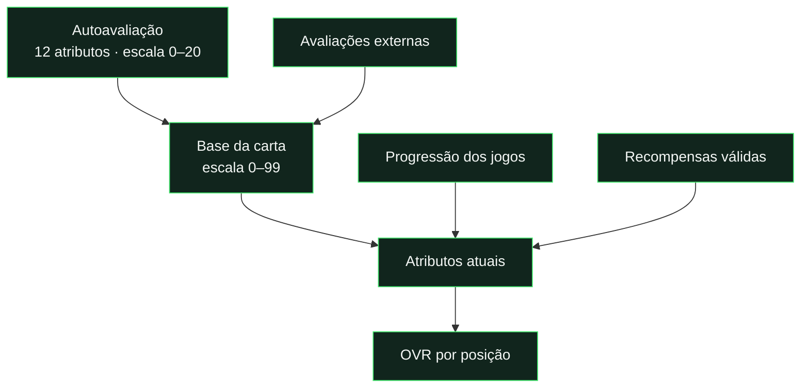
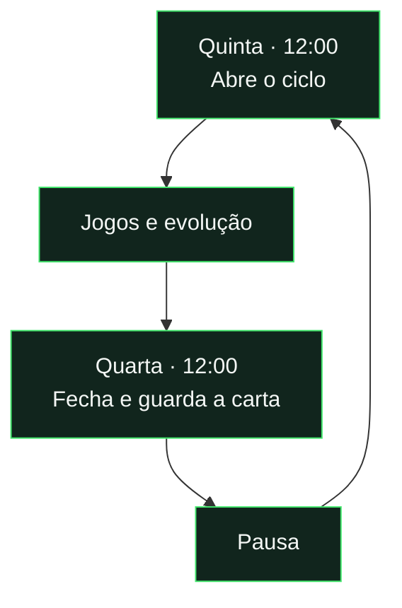

# Cartas, avaliações e OVR

[← Documentação](../README.md) · [Progressão por jogo](progression.md) · [Eventos](events-and-missions.md)

## A carta em três passos

| Momento                            | O que acontece                                        |
| :--------------------------------- | :---------------------------------------------------- |
| **Autoavaliação concluída**        | É criada a primeira carta.                            |
| **Primeiro voto externo completo** | A autoavaliação passa a ter peso máximo de 20%. |
| **Três votos externos completos**  | A carta passa a oficial.                              |
| **Jogos avaliados**                | Alimentam a progressão dos atributos.                 |
| **Fecho semanal**                  | Guarda a carta dessa semana no histórico.             |

## Distinguir os indicadores

| Indicador         | Significado                                                      |
| :---------------- | :--------------------------------------------------------------- |
| **Atributos**     | Capacidades individuais do jogador.                              |
| **OVR**           | Média ponderada dos 12 atributos pela posição principal.         |
| **Forma recente** | Últimas cinco avaliações agregadas de jogo disponíveis.          |
| **Forma semanal** | Desempenho no ciclo; exige pelo menos duas avaliações recebidas. |
| **—**             | Não há dados suficientes; não significa zero.                    |

## Ciclo semanal · hora de Lisboa

**Uma carta fechada conserva o estado da semana.** A posição muda os pesos do OVR, não os atributos.

[Ver a fórmula de progressão →](progression.md)

---

<strong>Regras completas e implementação</strong>

## Da primeira carta à carta oficial

A autoavaliação completa dos 12 atributos usa a escala 0–20 e permite criar a primeira carta. Desde o primeiro voto externo completo, o peso da autoavaliação é min(20%, 1 / (N + 1)), com N avaliações externas; com 1 a 4 avaliações externas. A partir de 5 avaliações externas, a referência é 4% para a autoavaliação e 96% para a comunidade. Os 96% são divididos pelas avaliações externas, truncando cada percentagem a duas casas decimais; o resto é somado à autoavaliação. Com 13 externas, cada uma pesa 7,38% e a autoavaliação 4,06%. Sem votos externos, a primeira carta provisória usa a autoavaliação. Com três avaliações externas completas, a carta passa a oficial.

Os valores são convertidos para a escala 0–99 da carta. Avaliações da comunidade, feedback de jogos e recompensas têm responsabilidades distintas: a comunidade estabelece a base; os jogos alimentam a progressão; os eventos aplicam recompensas validadas pelo servidor.

## Atributos e OVR

A carta acompanha velocidade, finalização, passe, drible, defesa, físico, guarda-redes, resistência, visão de jogo, posicionamento, jogo de equipa e compostura. O OVR é a média ponderada dos 12 atributos segundo a posição principal: GR, DEF, ALA, MED ou AV.

Cada conjunto de pesos soma 100%. A administração pode editar pesos e presets; o painel de auditoria apresenta os valores, pesos, contributos e arredondamento. A posição altera os pesos do OVR, não os atributos do jogador.

A penalização por inatividade começa após quatro jogos consecutivos da liga sem participação e pode chegar a dez pontos de OVR. O cálculo considera as regras de entrada do jogador e a participação, incluindo suplentes, implementadas em `js/utils.js`.

## Jogos, forma e estatísticas

O feedback de jogo usa a escala de estrelas. Guarda-redes N/A é excluído da média dessa dimensão. Dimensões não avaliadas não inventam uma avaliação. A evolução guarda decimais entre jogos e apresenta atributos arredondados na carta.

A fórmula considera avaliações absolutas e relativas às duas equipas, resultado, margem, golos e assistências, com ganhos/perdas limitados, boost de OVR baixo e desaceleração dos atributos elevados. Ver [a fórmula e simulação reproduzível](progression.md).

No início, “A minha carta” apresenta OVR, forma recente, jogos, vitórias, golos e assistências. A forma resume as últimas cinco avaliações agregadas de jogo disponíveis; “—” indica ausência de dados, não uma classificação de zero. Os totais de jogos e contribuições vêm de jogos finalizados.

O ranking semanal considera o ciclo e exige pelo menos duas avaliações recebidas para a forma semanal. O OVR serve de desempate e de referência quando faltam avaliações semanais. A página de estatísticas permite comparar a liga e ordenar os jogadores.

## Ciclo semanal

O ciclo abre à quinta-feira às 12:00 e fecha à quarta-feira às 12:00, em Lisboa. A pausa dura até à quinta-feira seguinte às 12:00. A conversão respeita inverno/verão e não depende do fuso do dispositivo.

As cartas na página principal e na lista de jogadores mostram apenas setas verdes ou vermelhas para a evolução de OVR e atributos face à semana anterior. Só no perfil são mostradas as diferenças numéricas: OVR, os 12 atributos e um resumo de quantos subiram ou desceram. Sem carta da semana anterior, não se inventa uma variação.

Quando o jogador tem mais de um tipo de carta disponível, o próprio perfil mostra «Escolher carta». A escolha aplica-se às cartas exibidas na aplicação durante a semana e só pode ser feita pelo jogador numa semana aberta. O fecho guarda o tipo selecionado no snapshot; o histórico mantém essa escolha. Com zero ou uma opção, ou após o fecho, o botão não aparece.

Uma carta fechada preserva atributos, OVR, especiais, posição e aparência. O histórico semanal permite ampliar essas cartas e consultar a evolução. Alterações posteriores não devem reescrever a memória visual de uma semana fechada.

## Identidade e recompensas

Há seis raridades base e cartas especiais reconhecidas por performances/recompensas. O Card Lab é um estúdio para compor estilos com modelos, paletas, camadas, molduras, fontes, efeitos e fotografia; inclui desfazer/refazer, importação/exportação JSON e composições guardadas.

Eventos e missões podem atribuir stats temporárias ou permanentes, cartas semanais, prestígio e conquistas. Elegibilidade, limites e privacidade estão na [referência de eventos e missões](events-and-missions.md).

## Implementação

[`js/utils.js`](../../js/utils.js) contém o cálculo de atributos, OVR e estatísticas; [`js/card-week.js`](../../js/card-week.js) define o ciclo. [`js/data.js`](../../js/data.js) combina dados e snapshots para apresentação. A escrita dos agregados/histórico e a validação de operações protegidas pertencem às Functions e às regras Firestore.

As avaliações (autoavaliação, comunidade e pós-jogo) podem ser editadas durante 7 dias desde a primeira submissão. Editar não reinicia o prazo nem permite voltar a rascunho. A data de criação é usada como referência nos registos antigos sem data de submissão. Após o prazo, ficam apenas para consulta; a restrição é aplicada também pelas regras e pelo servidor.

A carta base é Bronze comum para OVR inferior a 60 (incluindo 59) e Bronze rara de 60 a 64. Os restantes limites mantêm-se: Prata comum 65–69, Prata rara 70–74, Ouro comum 75–84 e Ouro rara a partir de 85.
