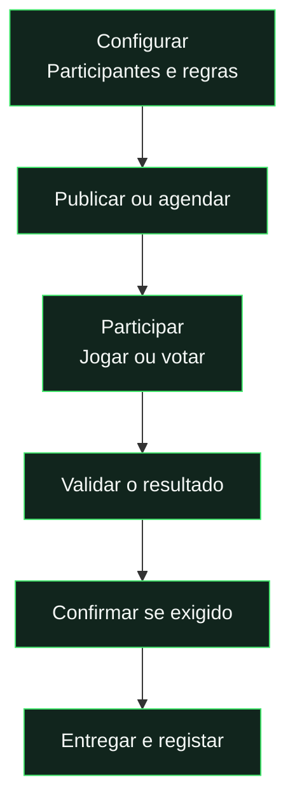

# Eventos, missões e recompensas

[← Documentação](../README.md) · [Cartas e OVR](cards-and-ratings.md)

## Escolher o formato

| Formato                   | Como se decide                     | Quem recebe                                         |
| :------------------------ | :--------------------------------- | :-------------------------------------------------- |
| **Missão**                | Cumprir um objetivo validado.      | Cada participante elegível que concluir e reclamar. |
| **Competição**            | Ordem de chegada à meta.           | As posições premiadas configuradas.                 |
| **Votação**               | Votos dos participantes elegíveis. | Os vencedores após apuramento.                      |
| **Competição controlada** | Ordem definida no ADMIN.           | As posições escolhidas e confirmadas.               |

## Da criação à recompensa

## Objetivos e prémios

| Objetivos                              | Recompensas                            |
| :------------------------------------- | :------------------------------------- |
| Jogos, golos, assistências e vitórias. | Stats temporárias ou permanentes.      |
| Sequências com regras próprias.        | Carta semanal ou combinação com Stats. |
| Participação individual ou coletiva.   | Aparência autorizada pelo servidor.    |

| Regra essencial               | Resultado                                      |
| :---------------------------- | :--------------------------------------------- |
| **Requisitos de desbloqueio** | A missão só aparece após cumprir as condições. |
| **Editar**                    | Conserva o estado e as entregas existentes.    |
| **Cancelar missão**           | Revoga as entregas dessa missão.               |
| **Apagar**                    | Apenas após cancelar e remover dependências.   |
| **Histórico fechado**         | As cartas semanais preservam os snapshots.     |

**O servidor valida progresso, votos e entregas.** O histórico público não expõe a identidade dos outros votantes.

---

<strong>Regras completas e implementação</strong>

O ADMIN gere esta área em `#/admin/events`; jogadores consultam calendário e histórico em `#/events`, tarefas em `#/missions` e detalhes em `#/event/{id}`.

## Gestão e resultados

O painel separa Eventos (classificação e vencedores) de Missões (objetivo e conclusão). A criação tem três passos: detalhes, classificação/objetivo e recompensas. Regras de votação e descrição/imagem ficam em opções recolhidas; missões não mostram posições premiadas nem medalhas na configuração. Criar, editar em qualquer estado, duplicar, publicar, agendar, cancelar, apagar cancelados, preparar resultados e confirmar a entrega. Eventos antigos continuam disponíveis com as regras originais; os novos usam `schemaVersion: 2` e partilham a infraestrutura existente.

A mesma lista de participantes determina votantes e candidatos. Mantém-se durante o evento, a menos que seja alterada explicitamente no editor. Até 20 posições premiadas, cada uma com recompensa própria; até 200 participantes e 10 escolhas distintas por votante. Um documento por votante: atualizar substitui o boletim e guarda a revisão na auditoria. Voto em si próprio, mínimo de votos, contagens em direto e confirmação ADMIN são configuráveis. Contagens em direto atualizam a consulta a cada cinco segundos. O desempate usa golos, participação ou identificador estável; igualdade final resolve-se sempre por identificador.

Métodos: votação, classificação manual pelo ADMIN ou objetivos verificados. O scheduler abre agendados, fecha os prazos e processa expirações a cada cinco minutos. O backend rejeita votos fora da janela, mesmo antes da execução do scheduler. Resultados que exigem confirmação ficam em revisão sem entregar prémios. Fecho e entrega são idempotentes, com IDs estáveis por evento/posição/jogador.

## Objetivos de missões

- Jogar X jogos finalizados, incluindo suplentes.
- Marcar X golos ou fazer X assistências, usando o registo validado do jogo.
- Ganhar X jogos.
- Obter X vitórias sem perder: empates preservam a sequência; derrotas reiniciam-na.
- Ganhar X jogos consecutivos: empates e derrotas reiniciam a sequência.

As sequências usam o melhor registo alcançado no período. Só contam jogos finalizados depois do início do período e até ao momento da consulta. Missões e eventos por objetivo têm três âmbitos: individual (números do jogador), grupo (soma das contribuições individuais dos participantes) e equipa (totais da equipa do jogador em cada jogo em que participou). No modo equipa, contam todos os golos do resultado da própria equipa e todas as suas assistências, incluindo colegas fora da missão, sem somar os adversários nem multiplicar o resultado pelo número de participantes. As vitórias e sequências seguem os resultados da própria equipa. Quem não participou não soma progresso de equipa. O antigo modo coletivo é interpretado como equipa. A janela começa na abertura/desbloqueio do objetivo e usa a data de encerramento do jogo: um jogo realizado antes pode contar se for encerrado depois. Frequências especial, diária e semanal: períodos de 24 horas/7 dias a partir do início, com máximo de 12 conclusões configuráveis e uma entrega por jogador/período. Cada jogador reclama a própria conclusão; o servidor verifica o objetivo e ignora qualquer progresso enviado pelo cliente. A dificuldade é configurável. Os objetivos são escolhidos no formulário; não existem desafios predefinidos.

## Recompensas e equilíbrio

Modalidades: Stats, carta ou ambas. A duração da recompensa pode ser semanal, mensal ou permanente e aplica-se às stats e à carta.

- Stats semanais e mensais: até +10 por atributo e +20 somados por prémio; acumulação de novos prémios limitada a +10 por atributo.
- Stats permanentes: máximo acumulado de +10 por atributo e por jogador, sem limite adicional para a soma dos atributos de uma recompensa.
- Carta: qualquer tipo padrão ou tema guardado no Card Lab. O servidor guarda a aparência autorizada, ignorando temas falsificados pelo cliente.
- Recompensas semanais duram sete dias; as mensais duram um mês de calendário a partir do início, ajustando o dia ao último dia do mês quando necessário. Durante a pausa das cartas, o início temporário passa para a próxima abertura. Stats e cartas permanentes não expiram, mas podem ser anuladas pela administração.
- Atributos respeitam o máximo 99. O registo conserva recompensa configurada e recompensa efetivamente atribuída, mesmo quando um limite reduz os pontos entregues.

Os jogadores podem consultar a pré-visualização dos prémios. O servidor distingue o prémio configurado do efetivamente entregue e aplica os limites globais de [Manutenção](maintenance.md). Efeitos de recompensas já entregues mantêm os montantes e validade registados.

## Histórico, privacidade e correções

Histórico público com datas, regras, classificação, votos agregados, pódio e recompensas. ADMIN consulta boletins com identidade/data, filtros de votante/candidato, entregas, anulações e ações registadas. Sinais de votos recíprocos são indicadores de revisão, sem acusação automática.

Recompensas, votos e auditoria só podem ser escritos pelo backend. A identidade dos outros votantes, edição dos prémios e auditoria são restritas ao ADMIN. A configuração fica numa subcoleção privada; notificações e resultados usam o mesmo registo de prémios efetivos. Medalhas distinguem as três primeiras posições; as seguintes usam numeração.

Antes da confirmação o ADMIN pode anular um boletim com motivo, conservando o original na auditoria. Depois da entrega pode anular os prémios com motivo: o registo fica preservado e deixa de produzir efeitos. Cancelar uma missão revoga entregas dessa missão. Cartas históricas fechadas preservam os snapshots originais; o estado atual recalcula após alterações.

## Resultados no telemóvel

A tabela de classificação transforma cada resultado num bloco por jogador até 600 px: posição, nome e votos/progresso ficam separados da recompensa, que ocupa a largura disponível. O mesmo formato é usado nos resultados iniciais e nas atualizações em direto, tanto em eventos como em missões. A ordem de classificação e os empates continuam a ser determinados pelas regras de apuramento; o layout não os recalcula.

Os objetivos que usam notas de guarda-redes recebem os agregados válidos: uma autoavaliação submetida com N/A impede que números enviados por colegas tornem esse critério elegível. Stats temporárias recebidas em prémios não contam para setas de evolução semanal.

## Verificação

Ao abrir um evento ou uma missão, os participantes elegíveis recebem uma notificação com acesso direto ao desafio. Inclui votações, competições por objetivo e competições controladas pelo ADMIN; não depende da existência de perguntas de votação. Rascunhos, utilizadores desativados e jogadores fora dos participantes não recebem o aviso. Missões com requisitos só notificam depois de desbloqueadas, através da verificação periódica. Cada desafio gera um único aviso de abertura por jogador, mesmo após edições ou novas verificações. O aviso segue também para os dispositivos com push ativo, usando o circuito descrito no [guia de notificações](../guides/notifications.md).

`npm.cmd test`: regras puras e objetivos. `npm.cmd run test:backend`: integração de eventos antigos e novos, entrega, missão, agendamento e confirmação. `npm.cmd run test:rules`: privacidade e escrita protegida. `npm.cmd run test:ui`: criação, pré-visualização, voto, compatibilidade e layout desktop/mobile.

## Missões sem prazo e desbloqueio

Em Detalhes, a opção **Sem prazo de conclusão** mantém a missão disponível até ser encerrada ou cancelada. As missões diárias e semanais mantêm a periodicidade e o limite de repetições configurados.

Em Objetivo, **Quando aparece ao jogador** permite escolher acesso imediato, conclusão de todas as missões selecionadas ou conclusão de pelo menos uma. O administrador continua a poder consultar e gerir todas as missões. Para os restantes jogadores, a lista e os detalhes só ficam disponíveis depois de cumprirem o requisito; o servidor também impede recolhas antecipadas.

Só contam jogos cuja data de encerramento esteja depois do desbloqueio e dentro do período da missão; é essa data, e não apenas a data agendada, que determina a janela. A conclusão de uma missão anterior continua válida depois de expirar o seu prémio temporário. Uma entrega anulada deixa de contar como conclusão. Não são permitidas dependências circulares ou referências à própria missão.

## Editar missões

O ADMIN pode usar **Editar** em qualquer missão, incluindo abertas, terminadas ou canceladas, e alterar os detalhes, as datas, os participantes, o objetivo, os requisitos, a periodicidade e a recompensa. **Guardar alterações** conserva o estado e todas as entregas existentes. As novas condições recalculam o progresso ainda por cumprir; recompensas já atribuídas não são alteradas nem entregues novamente por guardar a missão. Editar uma missão encerrada não a reabre.

## Apagar missões canceladas

O botão **Apagar missão** está disponível no ADMIN apenas para missões canceladas. A confirmação remove a missão, a configuração privada e os registos associados à missão. As entregas anuladas mantêm-se no histórico de recompensas e não alteram as Stats. Se a missão for requisito de outra, é necessário retirar essa ligação antes de apagar.

## Formatos de evento e competições

Eventos e missões admitem prazo indefinido, edição completa em qualquer estado e eliminação depois de cancelados. Guardar alterações preserva o estado e os prémios já entregues.

O editor distingue **Votação**, **Competição controlada** (ordem dos vencedores escolhida no ADMIN) e **Competição** (os primeiros a atingir uma meta). É possível definir os participantes, posições premiadas, recompensa de cada posição, desempate, visibilidade do progresso e confirmação antes da entrega.

As competições por objetivo aparecem nas Missões com o progresso do âmbito escolhido: individual, grupo ou equipa. Os objetivos disponíveis incluem jogos, golos, assistências, vitórias, vitórias consecutivas, vitórias numa sequência sem derrotas, jogos consecutivos sem perder, golos e assistências somados e jogos sem sofrer golos.

A ordem de chegada é verificada pelos jogos finalizados. Quem atingir a meta antes fica à frente, mesmo que outra pessoa tenha um total maior mais tarde. Se a meta for atingida no mesmo jogo, aplica-se o desempate configurado; uma ordem fixa resolve a igualdade restante. Não existem tempos individuais de golos registados dentro do mesmo jogo.

Ao preencher as posições premiadas, a competição encerra automaticamente (ou fica em revisão se exigir confirmação). A verificação ocorre ao finalizar/atualizar jogos e também a cada cinco minutos. Com uma posição premiada, o primeiro jogador a atingir a meta vence; com várias, o pódio segue a ordem de conclusão. Missões continuam a recompensar cada participante que cumprir o objetivo.

## Apresentação das recompensas

Os objetivos usam um ícone distinto por métrica e por método de decisão. As páginas dos desafios apresentam as recompensas por posição, com indicadores de stats/cartas e pré-visualização da carta usando os valores atuais do jogador. O detalhe público disponibiliza `rewardPreview`; a configuração administrativa e os boletins continuam reservados ao admin.

## Raridade visual

A raridade é escolhida no ADMIN ao criar ou editar eventos e missões. Bronze, Prata, Ouro, Especial Dourada, Elite, Ícone e Ultimate definem apenas a identidade visual: cores, emblema, bordas e efeitos. Não alteram dificuldade, objetivos, classificação, cálculos, recompensas ou cartas atribuídas. Registos anteriores sem raridade aparecem como Bronze. O valor é validado no servidor, conservado nas edições que não o especificam e copiado ao duplicar.

## Resumo dos objetivos nas missões

Cada cartão mostra uma frase curta com a ação e a meta. Os objetivos de estrelas distinguem média conjunta de mínimo por critério, comparações estritas e jogos consecutivos ou últimos jogos. Até dois critérios aparecem pelo nome; listas maiores indicam a quantidade. Mínimos de avaliações e regras completas continuam na página da missão. Esta apresentação não altera cálculos ou progresso.

As páginas de detalhe separam meta, critérios, requisitos mínimos e condições expansíveis, sem repetir as mesmas regras em parágrafos. Recompensas distinguem bónus de atributos, carta e duração. Um bónus igual nos 12 atributos é resumido numa linha; valores diferentes são apresentados numa lista de pares atributo/valor. O mesmo componente serve a pré-visualização, Por conclusão, recompensas configuradas, revisão administrativa e resultados. Validar com npm.cmd run test:event-details.

## Escolhe o teu caminho: próximo jogo

Os percursos têm um [catálogo próprio de 120 modelos](path-mission-catalogue.md) e não usam os períodos, sequências ou recolhas das missões criadas no editor de eventos. Cada tentativa vale apenas para o próximo jogo; condições compostas usam **E** e o avanço de 25/50/100%, ou raro de 150/200%, preenche nós de 100%. O boost é entregue ao completar o nó, não por simplesmente escolher uma missão. A [referência dos percursos](player-paths.md) descreve os limites próprios, raridades, fusões, sete votos/48 horas, cancelamentos e compatibilidade. O resumo da missão escolhida e a composição compacta usam o tema da sua raridade, com objetivo explícito **No próximo jogo** e recompensa integrada.
