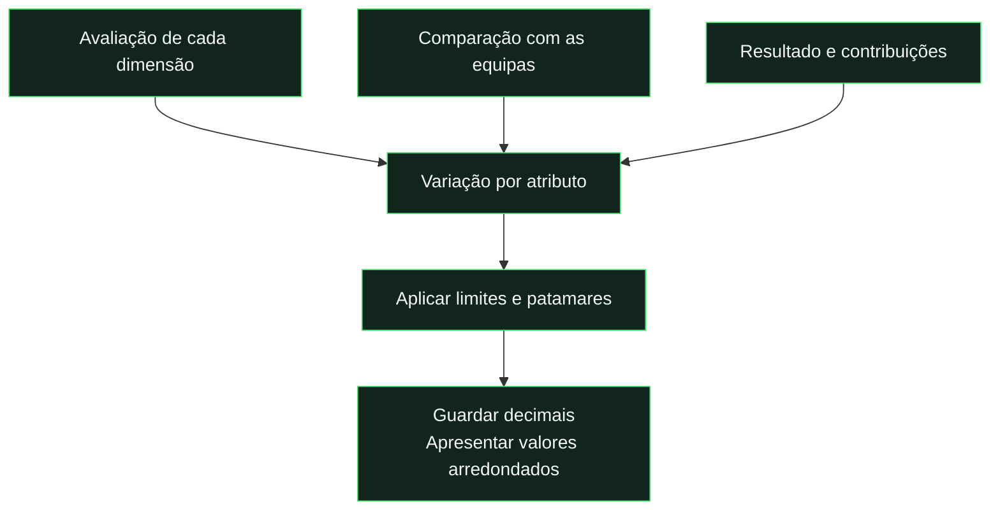

# Evolução por jogo

Os valores descritos abaixo são os valores iniciais. As regras configuráveis e a preservação do histórico estão descritas em [Manutenção](maintenance.md).

## Regras desde 26/10/2026

Em **Jogadores → (i) Como as tuas estatísticas mudam** (`#/players/evolution`), consultar o guia temático e experimentar o simulador local, que usa o mesmo motor da aplicação, com pesos de posição de referência e sem leituras adicionais de dados.

Jogos encerrados desde 26/10/2026 às 00:00 UTC usam `per-game-growth-v2`, implementado em [`js/game-progression.js`](../../js/game-progression.js). Os anteriores, incluindo feedback recebido mais tarde, conservam a fórmula original. A autoavaliação e a comunidade continuam a definir uma base variável; não foi introduzido congelamento da base.

- Nota neutra de 3 por dimensão; um mau desempenho pode perder atributos mesmo a vencer. N/A não inventa uma nota.
- Comparação gradual com os colegas: sem redução adicional até −0,75; conserva 85% a −1, 50% a −1,5 e 25% a −2, interpolando. Uma nota ≥3,5 conserva pelo menos 75% dessa componente.
- Golos reforçam Finalização, assistências reforçam Passe e os dois ajudam parcialmente Drible. A curva aproxima 1–3, distingue 4–5 e aumenta mais aos 6, saturando aos 10. Qualidade da dimensão, patamar e limites continuam a aplicar-se.
- Vitória por 1/3/5+ conserva 92/96/100% do ganho; empate 75%; derrota por 1/3/5+ conserva 60/50/40%. Perdas são atenuadas pela vitória e agravadas pela derrota.
- Defaults de velocidade 2,6, ganho máximo 5 antes do patamar e perda máxima 0,6. As configurações futuras explícitas podem ajustar estes três parâmetros.
- Patamares 1/0,7/0,4 abaixo de 75/85/90; a partir de 90, `0,12 × (99−atributo)/9`. Orçamento máximo de ganhos ponderados de +2,5 OVR exatos por jogo. Tetos e orçamento aplicam-se antes do fator de resultado, garantindo a ordem vitória ≥ empate ≥ derrota; o arredondamento da carta pode mostrar três inteiros.

O código é partilhado pelo navegador e Functions. Publicar ambos; depois, **Recalcular liga** atualiza cartas abertas, incluindo a remoção de descontos antigos de inatividade, mas não transforma jogos anteriores em v2 nem reescreve semanas fechadas. [Implementação, validação e deploy seletivo](../reports/progression-guide-implementation-2026-10-26.md).

[← Documentação](../README.md) · [Cartas e OVR](cards-and-ratings.md)

## O que faz um jogador evoluir



| Fator                           | Efeito                                                               |
| :------------------------------ | :------------------------------------------------------------------- |
| Avaliação acima das referências | Favorece ganhos.                                                     |
| Golos e assistências            | Acrescentam bónus nas dimensões previstas.                           |
| Vitória                         | Contribui para a evolução; não garante ganhos em todas as dimensões. |
| Atributos elevados              | Crescem mais devagar.                                                |
| Dimensão sem avaliação / GR N/A | Não altera os atributos dessa dimensão.                              |
| Carta semanal fechada           | Preserva o snapshot guardado.                                        |

## Exemplo de calibração da fórmula anterior

| Jogos   |   0 |   5 |  10 |  12 |  18 |  30 |
| :------ | --: | --: | --: | --: | --: | --: |
| **OVR** |  60 |  74 |  85 |  88 |  91 |  94 |

**É um cenário de teste, não uma previsão.** Usa um avançado com 4 estrelas, 3 golos e 2 assistências por jogo e 70% de vitórias; as condições completas estão abaixo.

```powershell
npm.cmd run simulate
```

**Limites principais:** atributos entre 0 e 99 · ganhos mais lentos no topo · +4 reservado a desempenho excecional.

---

<details>
<summary><strong>Regras completas e implementação</strong></summary>

Implementação partilhada pelo cliente e Cloud Functions: `js/player-calculation.js` coordena a base, os jogos, as recompensas e o OVR; `js/utils.js` escolhe a versão pela data do jogo. O cálculo atual não recebe atributos nem OVR de cartas semanais anteriores. As cartas fechadas são snapshots de apresentação e comparação. Os detalhes de fórmula abaixo descrevem `per-game-growth-v1`, preservada nos jogos anteriores a 26/10/2026.

Com 1 a 4 avaliações externas completas, o peso da autoavaliação é min(20%, 1 / (N + 1)), sendo N o número de avaliações externas. Com pelo menos 5, os 96% da comunidade são divididos igualmente pelas avaliações externas, truncando cada percentagem a duas casas decimais; a autoavaliação recebe os 4% de referência mais o resto. Exemplo com 13 externas: 13 × 7,38% + 4,06% = 100%. Sem avaliações externas, a primeira carta provisória usa a autoavaliação. A base é convertida de 0–20 para 0–99. Jogos são reproduzidos por data e ID; cada delta é somado sem arredondamento intermédio. O OVR de início do jogo usa os pesos da posição principal e atributos arredondados, sem penalização por inatividade.

Atributos atuais = base atual + variações dos jogos elegíveis + recompensas ativas. O OVR pondera esses atributos pela posição, sem desconto por inatividade. Jogos futuros, abertos ou em eliminação não entram. Recalcular começa sempre na base, sem somar novamente melhorias já aplicadas. Novos snapshots guardam baseStats e gameStats para distinguir a base das variações dos jogos. Depois de publicar a remoção da penalização, **Recalcular liga** atualiza as cartas abertas que ainda tenham descontos guardados; semanas fechadas conservam os seus valores históricos.

Alterar a autoavaliação ou a avaliação da comunidade altera a base, mesmo sem jogos novos. A autoavaliação pesa no máximo 20% até 4 avaliações externas e passa a 4% mais o resto dessa divisão a partir de 5; guardar os 12 valores a zero reduz a base. As comparações semanais incluem essas alterações, os jogos e as recompensas permanentes; excluem as temporárias.

## Autoridade da autoavaliação de guarda-redes

A autoavaliação pós-jogo submetida com guarda-redes N/A exclui todas as notas desse critério no jogo, incluindo notas de colegas anteriores. Isto retira o jogo das médias e da progressão de guarda-redes, mas mantém as restantes dimensões. Rascunhos não impõem esta exclusão; zero continua a ser uma nota válida. A implementação é partilhada pelo cliente, histórico e coleção.

A comparação entre semanas usa progressão e recompensas **permanentes**. A entrada, renovação ou expiração de bónus temporários não provoca setas de evolução, embora os números atuais da carta incluam os bónus ativos.

## Fórmula anterior · jogos até 25/10/2026

Por dimensão: `R = 0,70 × (estrelas − 3) + 0,30 × (estrelas − média dos colegas) + 0,20 × (estrelas − média adversária)`.
As médias excluem o próprio e avaliações N/A. Referências ausentes produzem diferença zero. Dimensão sem avaliação não altera atributos, incluindo guarda-redes N/A. Atitude substitui físico em resistência e ataque em compostura quando presente.

Resultado: vitória `0,40 + 0,06 × min(5, margem)`; empate `0,10`; derrota `−0,12 − 0,05 × min(6, desvantagem)`.
Bónus: finalização `min(0,90, golos × 0,725 × 0,25)`; passe `min(0,90, assistências × 0,725 × 0,30)`; drible `min(0,60, ações × 0,725 × 0,10)`. Em vitória multiplicam por `1 + 0,05 × min(5, margem)`.

Delta bruto: `R + resultado + bónus`. Vitória estagna se estrelas <2,5 ou diferença dos colegas <−0,5; nos restantes casos garante delta bruto ≥0,05.

Ganhos: `min(4, delta × 2,30 × boost × recuperação) × patamar`.

- `boost = 1 + 0,1 × clamp((80 − OVR)/5, 0, 1) + 0,5 × clamp((75 − OVR)/15, 0, 1)`.
- Recuperação só com diferença positiva face aos colegas: `1 + min(0,25, max(0, OVR_colegas − OVR)/40) × min(1, diferença/0,5)`.
- Patamar por atributo: <75 → 1; <85 → 0,7; <90 → 0,4; ≥90 → 0,12.
- Sem diferença ≥0,25 sobre uma das equipas e sem bónus individual, ganho fica limitado ao espaço até 90.

Perdas: `max(−0,45, delta) × (atributo <85 ? 0,7 : 1)`. Atributos limitados a 0–99.

## Referências e histórico

O OVR dos colegas vem de `gameBalances.playerOvr`, validado contra equipas e data de fecho. Sem snapshot válido o bónus de recuperação não é aplicado. As médias de estrelas são calculadas a partir dos agregados de cada jogador, por dimensão; no histórico só entram votos disponíveis até ao cutoff da carta. Os antigos ajustes de equilíbrio ±3 e a aceleração seletiva até 70 foram removidos.

Cartas semanais fechadas preservam os valores guardados. Cartas atuais e histórico explicitamente recalculado usam a fórmula nova. Não é necessária migração de documentos de jogos nem de avaliações.

## Simulação reproduzível

`npm.cmd run simulate` usa a função de produção. Avançado com todos os atributos a 60, 4 estrelas em cada dimensão de campo, colegas/adversários com média 3,8, colegas com OVR fixo 70; 3 golos e 2 assistências por jogo; resultados 7–5/5–7, ciclo de 70% de vitórias. Guarda-redes não avaliado.

| Jogos | OVR |
| ----: | --: |
|     0 |  60 |
|     5 |  74 |
|    10 |  85 |
|    12 |  88 |
|    18 |  91 |
|    30 |  94 |

Esta curva é um cenário de calibração, não uma garantia para todas as posições ou desempenhos. Testes específicos em `tests/progression.test.js` cobrem a curva, médias, limites, estagnação, perdas e precisão.

O teto abaixo de 75 mantém-se em +4. A parcela acima de +3 é multiplicada por `clamp(estrelas − 4, 0, 1) × clamp(max(diferença_colegas, diferença_adversários)/0,5, 0, 1)`. O ganho completo de +4 exige 5 estrelas e vantagem de pelo menos 0,5 face a uma das equipas. Avaliações de 4,5 podem ganhar até +3,5; avaliações iguais às médias não recebem esta parcela excecional. Na simulação de 4 estrelas, 88 é atingido no 12.º jogo.

</details>

## Evolução por jogo e avanço das missões

A progressão calculada a partir de jogos e avaliações e o avanço percentual de [Escolhe o teu caminho](player-paths.md) são mecanismos distintos. Nos percursos, +100% é avanço e +1 é um ponto permanente entregue ao completar um nó; os atributos continuam sujeitos aos tetos e aos orçamentos aplicáveis. Uma missão mista usa sete votos por critério no corte de 48 horas, sem substituir os requisitos próprios da evolução por jogo. A variedade v4 preserva propostas reveladas e semanas fechadas e não exige recálculo de dados existentes.
