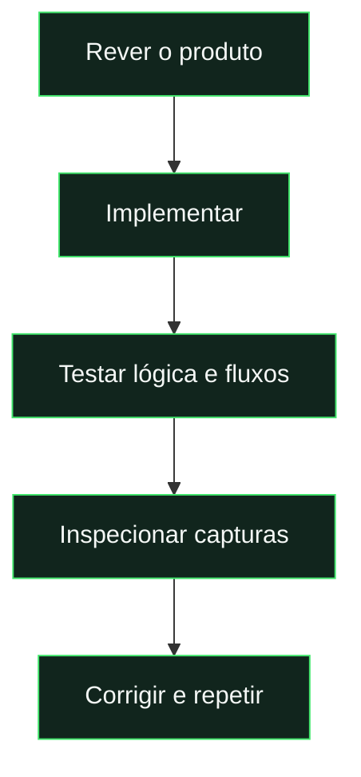

# Revisão da experiência e PWA

[← Documentação](../README.md) · [Guia PWA](../guides/pwa.md) · [Push](../guides/notifications.md)

## Resumo da revisão

| Área            | Trabalho registado                                       |
| :-------------- | :------------------------------------------------------- |
| **Interface**   | Tipografia, espaçamento, temas e estados.                |
| **Mobile**      | Navegação, pódio, estatísticas e administração.          |
| **Fluxos**      | Modais, pesquisa, notificações e navegação assíncrona.   |
| **PWA**         | Instalação, cache, offline e atualização adiada.         |
| **Push**        | Ativação, entrega, confirmação de leitura e diagnóstico. |
| **Repositório** | README visual, guias e exportação sem segredos.          |



**Este documento é um registo de trabalho.** Não prova que todas as alterações locais estejam publicadas. A entrega push real ficou dependente da correção do segredo cloud; ver o [estado das notificações](../guides/notifications.md).

---

<details>
<summary><strong>Registo completo da revisão</strong></summary>

Este documento regista a revisão local. Os procedimentos atuais de instalação e publicação estão nos guias; não confirma que o código local esteja publicado.

As alterações foram feitas sobre o estado existente do projeto, preservando o trabalho anterior e a identidade das cartas, os quatro temas e os fluxos da liga.

## Experiência

- Fonte Manrope alojada no projeto, com licença OFL e pesos fixos para renderização consistente em Chromium e WebKit. Hierarquia, textos de apoio e espaçamentos comuns revistos.
- Ícones de playstyles entregues em WebP de 256 px, com os PNG originais preservados. Os oito recursos passaram de mais de 7 MB para cerca de 107 KB; o pacote público completo ficou abaixo de 1 MB. A fonte variável de origem também é excluída do alojamento, que entrega apenas os pesos WOFF utilizados.
- Navegação mobile com Início, Jogadores, Jogos, Missões e Mais. O menu Mais reúne perfil, estatísticas, ranking, eventos, apoio, administração e instalação.
- Administração mobile com um seletor de área; menu desktop completo sem cortar a última opção.
- Pódio mobile com páginas por deslize e scroll snap; os três lugares continuam disponíveis sem uma longa pilha de cartas.
- Nomes longos nas cartas apresentados completos. Pesquisa de jogadores aceita nomes sem acentos e conserva os filtros ao voltar de um perfil.
- Estatísticas mobile com ordenação por seletor e cartões de jogador; indicadores da liga reorganizados para manter os rótulos legíveis.
- Estados de apoio, mensagens, eventos e desafios integrados na mesma linguagem visual. Cores de seleção seguem o tema escolhido.
- Modais bloqueiam o fundo, contêm o foco e restauram foco e scroll ao fechar. Confirmações canceladas por Escape, fecho, mudança de página ou clique no fundo terminam corretamente.
- Notificações lidas conservadas no histórico; o sino continua a mostrar apenas novidades. Fecho por Escape e por clique fora, sem interferir com atualizações do próprio painel.
- Respostas atrasadas de uma página não substituem a página para onde o utilizador navegou. Mensagens de carregamento e erros de ligação mais claras.
- Jogos mostram data, hora e local; edição e gravação usam Lisboa em qualquer fuso do dispositivo. Horas inexistentes na mudança para o horário de verão são rejeitadas. Na hora repetida de outono, usa-se a primeira ocorrência.
- Prazos de eventos e janelas de votação mostram também a hora. Os dados e regras de recompensas mantêm-se.
- O painel “A minha carta” deixou de esticar até à altura das missões. Inclui golos/assistências e acesso às estatísticas, com seis indicadores em três ou duas colunas conforme a largura.

## PWA

`manifest.webmanifest` define nome, identidade, idioma, âmbito relativo, arranque, modo standalone, cores e atalhos para jogos, missões e perfil. Os caminhos relativos permitem alojar o frontend na raiz ou numa subpasta.

Os ícones PNG de 192 e 512 px, o ícone maskable de 512 px e o apple-touch-icon de 180 px derivam do logótipo existente. `scripts/generate-pwa-icons.mjs` permite regenerá-los. Não é necessário gerar imagens por IA.

O service worker separa os caches por âmbito e versão. `build:hosting` gera uma versão a partir do conteúdo do frontend e injeta o inventário de recursos públicos. A instalação só termina quando os recursos da versão estão guardados. O documento e os módulos usam a mesma versão até à ativação da atualização; caches de outras aplicações no mesmo domínio são preservados.

O cache guarda recursos estáticos do frontend. Pedidos Firebase, APIs, fotografias privadas e gravações não são guardados nem reproduzidos pelo service worker. A liga requer ligação para consultar dados e guardar alterações. Sem Internet, uma abertura apresenta um ecrã próprio, com recuperação que verifica o servidor e conserva o destino original.

Uma atualização fica à espera. O utilizador recebe a opção de atualizar ou adiar, com indicação para guardar o trabalho. Não há recarregamento automático de formulários.

Android/Chromium usa o pedido nativo quando o browser disponibiliza `beforeinstallprompt`; há instruções de menu quando esse pedido não está disponível. No iPhone, a ajuda explica Safari → Partilhar → Adicionar ao ecrã principal, incluindo «Abrir como aplicação» quando aparece. As orientações seguem [Apple Support](https://support.apple.com/guide/iphone/iphea86e5236/ios) e [web.dev](https://web.dev/learn/pwa/installation).

O frontend tem metadados Apple e espaçamento para safe areas, alturas dinâmicas e modo standalone. O tema escolhido também atualiza a cor do browser.

## Validação e reprodução

```powershell
npm.cmd test
npm.cmd run check
npm.cmd run test:ui
npm.cmd run test:review
npm.cmd run test:pwa
npm.cmd run test:rules
npm.cmd run test:backend
npm.cmd run test:hosting
```

`test:review` percorre 27 rotas em 320, 360, 390, 430, 768, 1024 e 1440 px, além de 780×360, 844×390 e 932×430 na horizontal, com dados de demonstração, nomes longos, verificações de viewport, pódio, modais, pesquisa, ordenação e navegação durante um pedido lento. Guarda capturas em `test-results/review/`.

Para repetir em WebKit, instala o motor Playwright e executa `node tests/review.mjs --webkit`. Nesta revisão, o motor foi instalado em `test-results/browsers`; usa essa pasta em `PLAYWRIGHT_BROWSERS_PATH`. As capturas ficam em `test-results/review-webkit/`. WebKit no computador ajuda a detetar diferenças do Safari, mas não substitui um iPhone físico.

`test:pwa` usa o service worker real sobre o frontend preparado. Verifica manifest, dimensões dos ícones, entrega dos playstyles otimizados, âmbito na raiz e numa subpasta, recursos em cache, exclusão de pedidos privados, abertura offline, recuperação e atualização com adiamento. Um perfil normal do browser confirma os requisitos técnicos de instalação; contextos isolados verificam cache e atualizações. A ajuda para iOS é verificada com identificação de iPhone. A interface nativa de instalação do sistema operativo continua a exigir validação num aparelho real.

## Publicação e confirmação nos aparelhos

Este update inclui também [notificações push do telemóvel](../guides/notifications.md), com ativação voluntária, teste por dispositivo e leitura sincronizada. A primeira publicação destas notificações exige configurar a chave VAPID privada e publicar também as Functions e regras; o deploy apenas do frontend não é suficiente.

O frontend preparado está em `.firebase/site`. O fluxo Firebase existente (`npm.cmd run deploy:frontend`) inclui manifest, service worker, página offline, fontes e ícones. Não se publica código interno ou testes. O Hosting mantém revalidação HTTP, permitindo detetar novas versões do worker.

No GitHub Pages, publica os mesmos ficheiros da pasta preparada, mantendo-os na raiz da demo. O `sw.js` original é uma alternativa de desenvolvimento com cache mínimo; para publicar uma versão com o inventário e hash corretos, usa o ficheiro produzido pelo build.

Depois de publicar por HTTPS, confirma num iPhone e Android: instalação, lançamento pelo ícone, entrada na conta, navegação com safe areas, teclado nos formulários, fotografias, atualização e reabertura sem Internet. Esta revisão não publicou em produção nem verificou a instalação física ou credenciais do Firebase real.

## Estado de publicação e organização

O painel inicial das missões acompanha a altura natural de «A minha carta» no desktop. Apresenta até quatro entradas, com as competições primeiro, o total de pendentes e acesso à lista completa. Os cartões distribuem o espaço disponível sem scroll interno; no telemóvel, os painéis surgem em sequência e recuperam a altura natural. A página de Missões mantém todas as entradas e os seus grupos. O cenário de regressão verifica as alturas em 1440 e 1024 px, ausência de overflow em 390 e 320 px e acesso às cinco missões do exemplo.

O envio da chave privada VAPID para o Firebase Secret Manager foi rejeitado pela revisão automática por faltar autorização explícita para guardar o segredo na cloud. A chave foi gerada e preservada localmente; não houve deploy. A implementação push passou os testes locais de servidor, regras, worker e interface.

Na preparação para um repositório próprio, o README foi convertido numa apresentação visual, os guias separados da referência e deste relatório, e os originais de design movidos para `design/sources/`. Os módulos públicos mantiveram os caminhos. A exportação exclui segredos e ficheiros gerados; ver [mudança de repositório](../guides/repository-migration.md).

### Diagnóstico de entrega · 15 de outubro de 2026

Uma verificação posterior confirmou as funções push ativas em produção e o Android registado. Os registos de entrega mostraram erros 500 e ausência de envio concluído. A validação protegida da configuração identificou uma chave privada VAPID cloud com formato inválido: a construção do pedido falhava antes do contacto com o fornecedor push.

O par local foi validado e a chave pública coincide com a publicada. A correção preparada conserva esse par e as subscrições. O servidor passa a validar a chave privada e a correspondência antes de criar um teste, e guarda uma classificação segura da falha. Os testes de servidor constroem agora o pedido Web Push real encriptado/assinado, com chaves fictícias e sem enviar pela rede, além dos cenários de configuração inválida.

A substituição do segredo cloud e a republicação das funções dependem da autorização explícita necessária para essa operação de produção. Esta preparação local não confirma ainda a entrega num aparelho físico.

</details>
