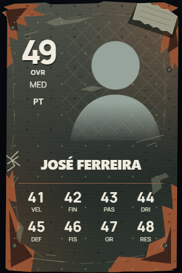

# Sucata: carta base até 49 OVR — 22/10/2026

[Documentação](../README.md) · [Cartas e avaliações](../reference/cards-and-ratings.md)

## Desenho e atribuição

Sucata (`scrap`) é o tipo base para OVR de 0 a 49. Bronze comum passa a 50–59; os restantes limites mantêm-se. A atribuição usa o OVR final apresentado na carta, sem alterar atributos, pesos ou progressão.

A composição usa chapa oxidada em cinzento esverdeado, ferrugem nos bordos, silhueta lascada, rebites, arame e fita adesiva. A rede velha fica atrás da fotografia. Nome, OVR e atributos têm contraste próprio, independente do tema do site. Não há nome de edição nem rótulos depreciativos dentro da carta. O nome Sucata e o intervalo de OVR aparecem no catálogo, fora da composição.

O desenho é vetorial nativo, com padrões locais e sem filtros animados, imagens externas, uploads ou bibliotecas novas. Os recortes mantêm a área segura de texto. Cada carta tem identificadores SVG próprios. O foco por teclado mantém-se visível; não foi introduzido movimento contínuo.

Os jogadores abaixo de 50 que tragam o tipo Bronze em dados antigos apresentam Sucata na carta base atual. Cartas especiais conquistadas e a seleção de uma edição especial mantêm-se. Pré-visualizações explícitas do catálogo podem mostrar qualquer edição. Em Forma continua a usar o seu material Bronze nos jogadores abaixo de 50. Jogadores sem carta criada mantêm a apresentação sem OVR, sem serem classificados visualmente como Sucata.

## Dados e publicação

`calculateBaseCard` é partilhado pelo navegador e servidor. Os novos snapshots passam a gravar `baseCard: "scrap"` quando aplicável; a apresentação normaliza o tipo base de snapshots antigos abaixo de 50, preservando os atributos e o OVR congelados. Não se reescrevem documentos históricos nem se recalculam semanas fechadas para mudar o material. A cache de `getHome` tem nova versão para atualizar os tipos apresentados.

Publicar **`npm.cmd run deploy:scrap-card`** e **`npm.cmd run deploy:frontend`**. O primeiro comando publica seletivamente os consumidores do cálculo, catálogo e nomes das cartas indicados abaixo. Não há alterações a regras, índices ou Storage. Não é necessária uma migração nem um recálculo global. Não foi executado deploy nem foram consultados dados cloud.

## Validação local

- 182 testes de lógica aprovados, incluindo fronteiras 49/50, tipos antigos, especiais, pré-visualizações explícitas, IDs SVG e snapshots bloqueados.
- Emulador: criação das cartas Sucata e Bronze, consistência com `getHome` e preservação de um snapshot histórico bloqueado. As quatro verificações de regressão da coleção também passaram.
- Browser com serviços reais bloqueados: quatro temas, larguras 320/390/768/1440, OVR zero, nomes longos e foco por teclado. Capturas desktop/telemóvel inspecionadas, sem overflow horizontal.

`npm.cmd run test:scrap-card` executa lógica e browser. `node tests/scrap-card.mjs --docs` renova a imagem individual e a galeria dos sete tipos base. O teste `tests/scrap-card.backend.test.js` exige emulador Firestore local e projeto `demo-*`.

Funções selecionadas: `onCommunityRating`, `onPlayerPosition`, `onInitialRating`, `onFeedback`, `onGame`, `saveOvrWeights`, `rebuildHistory`, `closeCardWeek`, `openCardWeek`, `ensureHistory`, `refreshCardCollection`, `selectWeeklyCard`, `rebuildLeague`, `deleteGame`, `saveWeeklyCardPhoto`, `correctRating`, `eventAction`, `voteEvent`, `closeEvents`, `getEvent`, `listEvents`, `claimMission`, `getPath`, `pathAction`, `onPathGame`, `onPathSummary`, `settlePaths`, `gameAction`, `feedbackAction`, `maintenanceAction`, `systemHeartbeat`, `saveTheme`, `ensureGameCards`, `maintenanceRead`, `getHome`, `processFeedback`, `onEventNotifications`, `scheduledNotifications`.
