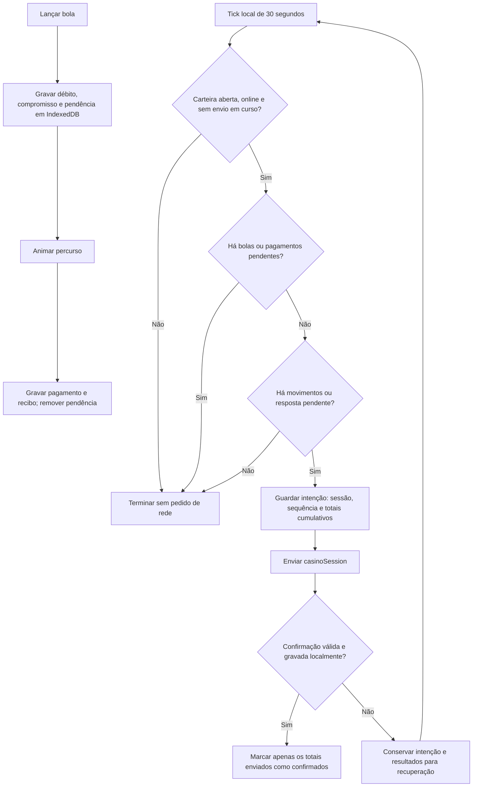

# GANZÁ — pipeline de confirmação da carteira

## Regra

Enquanto o GANZÁ está montado, a cada **30 segundos** verifica-se o estado que já está em memória. O tick não consulta o Firebase para saber se houve alterações e não grava nada em IndexedDB se não existir trabalho a confirmar.

Só há uma tentativa de confirmação automática quando:

1. A carteira está aberta e o navegador não indica que está offline.
2. Não existe uma confirmação em curso.
3. Não há nenhuma bola pendente no registo local.
4. Existem movimentos não confirmados ou um pedido anterior cuja resposta falta.

Uma bola só sai do registo pendente **depois de o pagamento estar gravado duravelmente**. O fim da animação, por si só, não permite enviar o lote. A verificação usa o mesmo lock local dos lançamentos e liquidações.

Não há envio imediato ao terminar uma sequência: aguarda-se o próximo tick. Se houver bolas continuamente durante dez minutos, todos os ticks são locais e não há confirmação automática nesse período. Não existe uma atualização periódica forçada da base de dados.

## Percurso dos dados



Os ticks não executam `getCasinoWallet`, não abrem listeners nem pedem `open`. Os controlos, o histórico e a animação continuam a ler o saldo local. A entrada no casino e as operações explícitas mantêm as verificações online já existentes.

“Houve alterações” significa **movimentos não confirmados**, e não apenas saldo final diferente. Um lote com apostas de 53 DJC e pagamentos de 53 DJC precisa de ser confirmado, embora o saldo líquido não tenha mudado.

## Exemplo de utilização

| Momento | Estado | O que acontece |
| --- | --- | --- |
| Entrada | Abrir a carteira | Procedimento online existente; fora dos ticks |
| 0–25 s | Foram lançadas várias bolas | Cada débito e pagamento é guardado localmente |
| 30 s | Ainda existe uma bola pendente | Zero pedidos do tick |
| 35 s | Último pagamento guardado | Aguarda; não envia por bola nem por fim de animação |
| 60 s | Sem bolas e com movimentos pendentes | Um pedido confirma o lote acumulado |
| 90 s | Sem movimentos novos | Zero pedidos e zero escritas locais do tick |
| Saída | Pode haver movimentos pendentes | O ciclo existente tenta confirmar/fechar a sessão |

## Concorrência e recuperação

- **Nova bola antes da decisão:** se o lançamento tiver adquirido o lock primeiro, a verificação encontra a pendência e não envia.
- **Nova bola depois de um envio já começar:** o pedido não é cancelado nem bloqueia o jogo. Confirma apenas o snapshot enviado; os movimentos novos continuam guardados e pendentes. A resposta antiga não os apaga.
- **Outro tick durante o envio:** é ignorado, sem enfileirar um segundo envio automático.
- **Offline conhecido:** não se tenta sequer contactar a rede. Os movimentos locais mantêm-se.
- **O navegador diz online, mas a rede falha:** conserva-se o pedido antes da chamada. O próximo tick elegível repete exatamente a mesma sessão, sequência e totais.
- **O servidor gravou, mas a resposta perdeu-se:** reenviar o mesmo pedido obtém a mesma confirmação sem pagar novamente.
- **A resposta chegou, mas o disco encheu:** o pedido continua pendente. A confirmação só é considerada concluída quando também fica guardada localmente.
- **Já existe um pedido antigo e entraram novas bolas:** não se tenta reenviá-lo enquanto houver bolas. Depois, confirma-se primeiro esse pedido; os movimentos posteriores seguem num tick elegível seguinte.
- **Sair com bolas em curso:** a saída é uma exceção ao bloqueio do tick e pode confirmar os débitos já gravados. As bolas e os pagamentos ainda pendentes permanecem no dispositivo e são retomados ao reabrir.
- **Duas abas no mesmo navegador:** o lock exclusivo existente impede a segunda aba de abrir a mesma carteira.

Fechar abruptamente o browser não garante que a chamada de saída termine. Se os dados do navegador forem eliminados antes de uma confirmação, não existe recuperação cloud desses movimentos locais. Esta alteração não muda o modelo de confiança: os resultados continuam calculados no cliente; não constitui validação antifraude no servidor.

## Testes exigentes e resultado esperado

O teste usa a carteira real do frontend, IndexedDB do browser, a autoridade simulada que executa o redutor de sessão e um relógio controlado para o temporizador. Todas as origens externas estão bloqueadas. Não consulta dados reais, não mede faturação e não comprova configuração cloud ou publicação.

| Cenário automatizado | Garantia verificada |
| --- | --- |
| Carteira limpa, 100 verificações | Zero pedidos adicionais e zero escritas em IndexedDB |
| 100 bolas simultâneas | Nenhum envio até ao último pagamento; um único lote depois |
| Offline e regresso da ligação | Sem tentativa offline; lote confirmado ao voltar |
| Falha de rede repetida | Intenção persistente e corpo idêntico nos reenvios |
| Resposta perdida após commit | Pagamento e sequência não duplicam |
| Resposta perdida seguida de novas bolas | Nenhum reenvio em voo; lotes antigos e novos não se misturam |
| Lote com saldo líquido zero | Apostas e pagamentos confirmam mesmo sem alteração do saldo final |
| Resposta lenta, novas bolas e recompensa externa | Preserva os três estados sem bloquear jogadas nem perder dinheiro |
| Corrida entre lançamento e tick | O lançamento que ganha o lock impede o envio |
| Disco cheio no lançamento | Sem débito publicado nem confirmação indevida |
| Disco cheio na liquidação | Bola continua pendente; repetir o pagamento é idempotente |
| Disco cheio ao guardar a confirmação | Reenvio não duplica o commit remoto |
| Saída offline com bola em voo e reload | Débito e pagamento exato recuperados |
| Saída com resposta perdida e reload | Mesmo pedido recuperado sem segundo pagamento |
| Fecho durante confirmação lenta | Aguarda, fecha uma vez e rejeita apostas novas |
| Segunda aba | Carteira exclusiva preservada |
| Relógio do host e desmontagem | Tick aos 30 s; sem rede em estado limpo/ocupado; temporizador cancelado ao sair |

Executar na raiz:

```powershell
npm.cmd run test:casino:ganza:sync
node tests/casino-local-wallet.mjs
node --test tests/casino-session.test.js
node games/ganza/tests/integration.mjs
npm.cmd run test:docs
```

Código: [host e temporizador](../../../js/casino-ganza-host.js), [carteira e checkpoint](../../../js/casino-local-wallet.js), [cenários exigentes](../../../tests/casino-ganza-sync.mjs).
